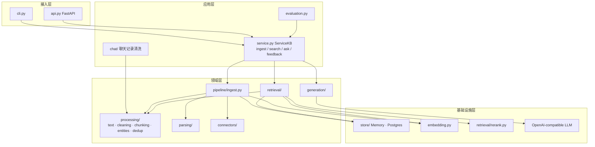
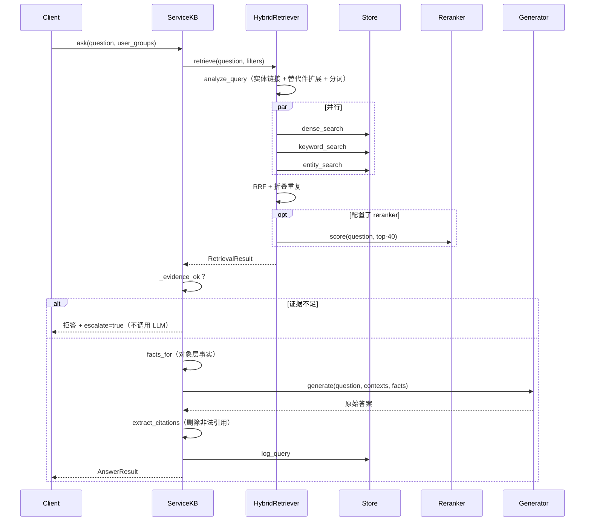

# 01 架构总览

## 1. 分层



**依赖方向只能从上往下。** 领域层不知道 FastAPI 的存在，存储层不知道 prompt 长什么样。好处：换数据库只改 `store/`，换 Web 框架只改 `api.py`。

## 2. 设计原则

1. **离线优先**：默认配置不依赖 GPU / API / 数据库，新人 clone 下来就能跑；每个外部依赖都有可替换的实现。
2. **对象层先行**：先把型号、料号、故障码建成对象（带唯一 ID 和别名），再处理文档。文档块通过 `entity_ids` 挂到对象上。
3. **一切可重放**：确定性 ID + 内容哈希 + pipeline 版本 → 同样的输入永远得到同样的结果，跑多少次都一样（幂等）。
4. **失败是常态**：单个文档失败不影响整体；模型服务挂了降级为抽取式回答；日志写失败不影响回答。
5. **可观测**：每次导入写 `ingestion_runs`，每次问答写 `query_logs`，包括每一路检索的排名和各阶段耗时。
6. **接口小**：Connector 只需实现 `iter_events()`；Store、Embedder、Reranker、Generator 都是几个方法的抽象类。

## 3. 数据模型的流转

```text
Connector.iter_events()
   └─ SourceRecord          原始记录（bytes/str + 元数据 + ACL）        models.py
        └─ parse()
             └─ ParsedDocument   Block 列表（heading / paragraph / table / qa / record）
                  └─ chunk_document()
                       └─ ChunkDraft     正文 + 标题路径 + 页码
                            └─ IngestionPipeline.build_chunks()
                                 └─ Chunk   + chunk_id / entity_ids / keywords / simhash / embedding
                                      └─ Store.replace_document()   原子写入
查询：
   question ─ analyze_query() ─ QueryAnalysis（实体、扩展实体、分词）
            ─ 三路检索 ─ list[(Chunk, score)] ×3
            ─ reciprocal_rank_fusion() ─ list[ScoredChunk]
            ─ Generator ─ AnswerResult（答案 + Citation + escalate）
```

## 4. 一次 ask 的时序



## 5. 扩展点

| 想做的事 | 改哪里 | 需要实现 |
| --- | --- | --- |
| 新数据源 | `connectors/` | `Connector.iter_events()`（可选 `entities()`、`next_state()`）|
| 新文件格式 | `parsing/` | `def parse_xxx(record) -> ParsedDocument`，注册到 `PARSERS` |
| 新切块策略 | `processing/chunking.py` | 新的 Block 类型或分支；记得改 `PIPELINE_CODE_VERSION` |
| 新向量库 | `store/` | `Store` 的全部抽象方法 |
| 新向量模型服务 | `embedding.py` | `Embedder.embed_documents()` |
| 新检索通道 | `retrieval/retriever.py` | 在 `channels` 里加一路，RRF 自动融合 |
| 新 LLM | `generation/generator.py` | `Generator.generate()`；OpenAI-compatible 的服务直接改配置即可 |

## 6. 配置

所有参数在 `config.py` 的 `Settings` 里，通过环境变量（`SERVICEKB_` 前缀）或 `.env` 覆盖。数据源单独放在 `configs/sources.yaml`，因为它是"数据"而不是"参数"，业务人员也可能改。

## 7. 线程与并发

- 三路检索用线程池并行（`HybridRetriever._pool`），Postgres 连接池默认 10 个连接。
- API 是同步端点（FastAPI 会放进线程池执行），适合 IO 密集的检索 + LLM 调用。
- 内存模式不支持多 worker（每个进程一份数据）；Postgres 模式可以 `servicekb serve --workers 4`。
- 导入是单进程顺序执行，同一数据源不要并发导入（会互相覆盖游标）。大规模导入的改进见路线图。
