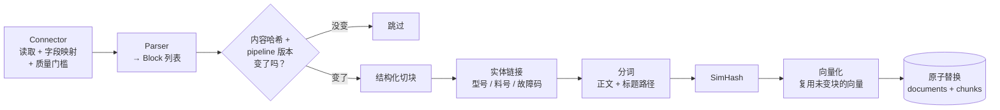

# 02 数据 pipeline

> RAG 效果的上限由数据决定。检索和生成调得再好，也救不了"垃圾进"。
>
> 代码：`connectors/` → `parsing/` → `processing/` → `pipeline/ingest.py`

## 1. 全流程



运行：`servicekb ingest`（全部数据源）或 `servicekb ingest --only manuals`。

## 2. 数据源与 Connector

| 数据源 | Connector | 同步语义 | 主要处理 |
| --- | --- | --- | --- |
| 领域词典 YAML | `entity_dictionary` | 全量 | 只产出实体（型号别名、故障码），不产出文档 |
| 物料主数据 CSV/XLSX | `parts_master` | 全量 | 合并重复料号、规范化、产出实体 + 关系 + 每料号一条记录 |
| 手册 / 通告文件夹 | `filesystem` | 全量 | 按扩展名选择解析器；目录不存在直接报错 |
| 历史工单 JSONL/CSV | `qa_archive` | 全量 | 字段映射、去邮件噪声、PII 脱敏、**只收已解决且有答案的** |
| Teams 聊天提炼 | `qa_archive`（`doc_type: chat`） | 全量 | 先跑 `servicekb chat clean`，见 [09](09_chat_log_cleaning.md) |
| SharePoint | `sharepoint` | **增量**（delta） | 显式墓碑删除、限流重试、deltaLink 游标 |

### 2.1 顺序：对象层先行

`configs/sources.yaml` 里**词典和物料主数据必须排在文档前面**。原因：文档入库时要做实体链接，如果对象层还没建好，"AS110K" 就识别不出来是 `model:AS-110K-HV`。

词典或物料主数据变化后，`pipeline_version` 里的"词典指纹"会变，所有文档会自动重新做实体链接（向量复用，所以很快）。

### 2.2 全量 vs 增量：删除逻辑

这是最容易出事故的地方：

- **全量快照**（`full_snapshot = True`）：本次没出现的文档 = 源头已删除 → 删除。
  但如果"消失"的比例超过 `max_delete_ratio`（默认 50%，且该源至少有 10 份文档），**拒绝删除**并报错：通常是网盘没挂上、导出文件不完整。确认无误后用 `--force-delete`。
- **增量**（`full_snapshot = False`）：只返回变化的记录。**绝不能**因为"本批没出现"就删除，只认数据源显式给出的 `Tombstone`。

### 2.3 质量门槛（以工单为例）

```python
status not in resolved_statuses  → 过滤（filtered_unresolved）
len(answer) < min_answer_chars   → 过滤（filtered_no_answer）
```

被过滤的数量记录在 `ingestion_runs.stats.connector_stats` 里。和业务方对账时可以直接说："导出 21 张，19 张入库，2 张没有结论。"

## 3. 解析：统一的 Block 中间表示

所有格式都转换成 `Block` 列表（`models.py`）：

| kind | 含义 | 来源 |
| --- | --- | --- |
| `heading` | 标题，带 `level` | Markdown `#`、Word 样式 "Heading N"、PDF 编号规则 |
| `paragraph` / `list` | 正文 / 列表 | 各种格式 |
| `table` | 表格，`rows[0]` 是表头 | Markdown 表格、Word 表格、Excel sheet |
| `qa` | 一组问答，`fields` 里有 question / answer | 工单、聊天提炼 |
| `record` | 一条结构化记录 | 物料主数据 |

### 3.1 各格式的注意事项

- **Markdown**：最理想的格式。支持 YAML front matter（`title`、`product_models`、`doc_type`）。注意：front matter 里的 `acl_groups` **会被忽略**——权限只由管理员在 sources.yaml 里配置。
- **PDF**（`pypdf`）：只抽文本层。标题靠编号规则识别（"第X章"、"1.2.3 xxx"、"Chapter 1"、"（一）"，借鉴 RAGFlow）。平均每页少于 20 个字符时判定为扫描件并报错——扫描件请设置 `SERVICEKB_PDF_PARSER=docling`（需要 `pip install -e ".[docling]"`），或用 MinerU 预处理成 Markdown。
- **Word**：按 body 元素顺序遍历（`python-docx` 的 `paragraphs` 和 `tables` 是分开的，直接用会打乱顺序）。
- **Excel**：每个 sheet 一个标题 + 一张表。复杂的多表 sheet 需要定制。

## 4. 清洗

`processing/cleaning.py`，入口 `clean_text(text, email_like=True)`：

1. **规范化**（`normalize_text`）：全角字母数字转半角（`ＡＳ－１１０Ｋ` → `AS-110K`），但**保留中文标点**；去零宽字符、控制字符；合并多余空白。
2. **邮件去噪**（`strip_email_noise`）：从 `-----Original Message-----` / `From:` / `发件人：` / `On … wrote:` / `在…写道：` 处截断；删除 `>` 引用行；在正文后半部分识别签名（`Best regards`、`此致`、`谢谢`……）；删除免责声明。
3. **PII 脱敏**（`redact_pii`）：邮箱 → `[EMAIL]`，手机 / 电话 → `[PHONE]`，身份证 → `[ID]`。**不脱敏**设备序列号和料号。

## 5. 切块

`processing/chunking.py`。参数（`.env`）：

| 参数 | 默认 | 说明 |
| --- | --- | --- |
| `CHUNK_MAX_TOKENS` | 450 | 单块上限。中文约 450 字 |
| `CHUNK_OVERLAP_TOKENS` | 60 | 相邻块重叠（只在同一章节内）|
| `CHUNK_MIN_TOKENS` | 15 | 过短的文本块丢弃（孤立的"注意"、页眉残留）|

规则：

- **章节边界不跨越**：一个块只属于一个小节。
- **标题路径**存进 `heading_path`，向量化时拼在正文前（`Chunk.embed_text()`），但**不写进** `text`。这样召回更准，引用片段又干净。
- **超长段落**按句切：中文按 `。！？；`，英文的 `. ! ?` 后面必须有空格才切（否则 "V2.3.0"、"310-04521-B." 会被切坏）。
- **表格**：单独成块；大表按**整行**拆，每块重复表头。
- **问答**：原子块，格式 `问题：…\n回答：…`；答案太长时拆分，但每块都带问题。
- **记录**：一行一块，渲染成 `- 字段: 值`，空字段去掉。

**怎么调**：先看数据。`servicekb search` 的结果里如果经常看到"答案被切成两半"，加大 `max_tokens` 或 `overlap`；如果一个块里混了好几件事，减小 `max_tokens`。改完必须跑 `servicekb eval` 对比。

## 6. 增强：实体链接、分词、指纹

对每个块（`pipeline/ingest.py::build_chunks`）：

- **实体链接**：正则找料号 / 故障码候选，型号候选按别名表查找，中文零件名按最长匹配查找。结果写入 `entity_ids`。料号格式由 `SERVICEKB_PART_NUMBER_PATTERN` 控制，**接入真实数据时必须改成你们的格式**。
- **未登记实体**：文档里出现、物料主数据里没有的料号，记在 `metadata.unknown_entities`。这是"物料主数据完整性"的数据质量信号。
- **机型**：块里明确提到型号就用块内的；否则继承文档级的（front matter / 工单字段 / 标题）。
- **分词**：正文 `keywords` 和标题 `heading_keywords` 分开存，关键词检索时标题权重较低。实体的规范名也作为额外 token 加入（"AS110K" 写法的工单也能被 "as-110k-hv" 搜到）。
- **SimHash**：用于检索时折叠近似重复。

## 7. 增量、幂等、向量复用

三个哈希 / 版本决定一份文档要不要重新处理：

| 名称 | 由什么决定 | 变化时 |
| --- | --- | --- |
| `doc_id` | `sha256(source_id, external_id)` | 不会变（同一份文档永远同一个 ID）|
| `content_hash` | 标题、类型、ACL、机型、解析后全文、元数据 | 这份文档重新处理 |
| `pipeline_version` | `PIPELINE_CODE_VERSION` + 切块参数 + 向量模型 + 词典指纹 | **所有**文档重新处理 |

块 ID = `sha256(doc_id, sha256(标题路径 + 正文), 同内容序号)`。文档重新处理时，**块 ID 没变的直接复用旧向量**，只有新内容需要调用模型。

```text
修改手册里的一句话 → servicekb ingest --only manuals
│ manuals │ succeeded │ updated 1 │ unchanged 2 │ emb new/reused 1/10 │
```

## 8. 故障隔离

| 故障 | 行为 |
| --- | --- |
| 单个文档解析失败 | 记为 `failed`（错误信息、失败次数），**保留旧版本的块**，继续处理其他文档；下次运行自动重试 |
| 向量模型服务不可用 | 这一批文档记为失败，下次重试 |
| 写数据库失败 | 该文档事务回滚，记为失败 |
| 数据源整体不可用（目录不存在、Graph 401） | 本次运行 `failed`，不删除任何数据，**不保存游标** |

每次运行的结果写在 `ingestion_runs` 表里：

```sql
SELECT source_id, status, stats->>'added' AS added, stats->>'failed' AS failed, finished_at - started_at AS took
FROM ingestion_runs ORDER BY run_id DESC LIMIT 20;
```

## 9. 数据质量报告

| 命令 | 内容 |
| --- | --- |
| `servicekb audit parts` | 重复料号（不同名字）、相似名称不同料号、引用了不存在的替代料号 |
| `servicekb audit qa` | 近似重复的工单簇、被质量门槛过滤的数量 |
| `servicekb chat clean` | 聊天清洗漏斗、丢弃原因、名册缺失、未知料号 |

这些报告是和业务方沟通"数据底子"的最好材料：名字不统一、按记录而不是按对象存、相似名重复……都能量化出来。

## 10. 新增一个数据源（示例：ServiceNow 工单）

```python
# src/servicekb/connectors/servicenow.py
class ServiceNowConnector(Connector):
    full_snapshot = False  # 用 sys_updated_on 增量拉取

    def __init__(self, source_id, instance, table="incident", acl_groups=None):
        ...

    def iter_events(self, state):
        since = (state or {}).get("since", "1970-01-01 00:00:00")
        for row in self._fetch(since):              # 分页调用 REST API
            if row["active"] == "false" and row["close_code"] == "Duplicate":
                yield Tombstone(self.source_id, row["number"])
                continue
            yield SourceRecord(..., mime_type=QA_MIME, content=json.dumps({...}))
            self._max_updated = max(self._max_updated, row["sys_updated_on"])

    def next_state(self):
        return {"since": self._max_updated}
```

然后在 `connectors/__init__.py` 的 `CONNECTOR_TYPES` 注册，在 `sources.yaml` 加配置，写一个用 `httpx.MockTransport` 的测试（参考 `tests/test_connectors_api_eval.py` 里的 SharePoint 测试）。
