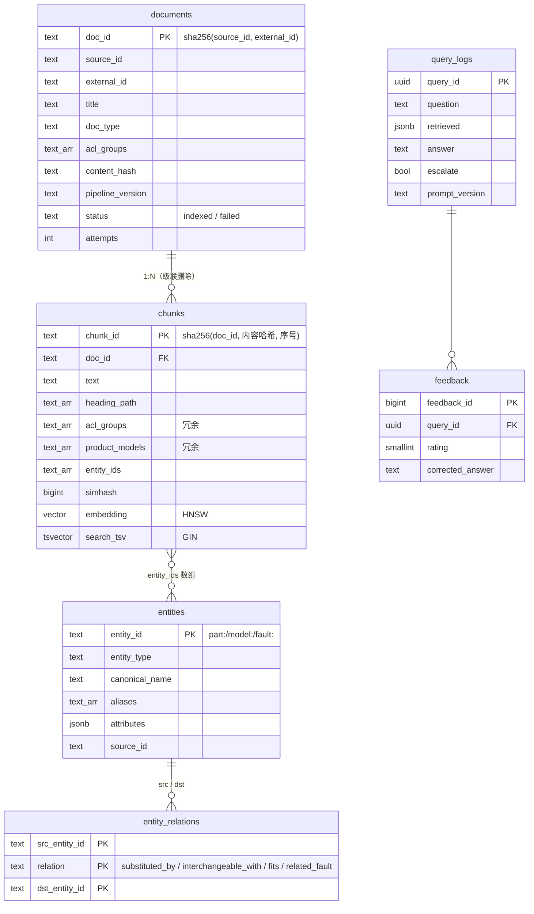

# 03 数据库设计

> 一个 PostgreSQL 同时当关系库、向量库、全文库。表结构：`src/servicekb/store/migrations/001_init.sql`（每个字段都有注释）。

## 1. 为什么是 PostgreSQL + pgvector

| 方案 | 优点 | 缺点 | 结论 |
| --- | --- | --- | --- |
| **PostgreSQL + pgvector** | 一套系统；事务；SQL 过滤 / join；备份、高可用、监控都是成熟方案；托管服务多 | 千万级以上向量、专业 BM25 不如专用系统 | ✅ 3~4 人团队的最佳起点 |
| Milvus / Qdrant / Weaviate | 向量检索性能和功能更强 | 还需要另一个数据库存文档、实体、日志；两边一致性要自己保证 | 数据量到千万级再考虑 |
| Elasticsearch / OpenSearch | 真 BM25、中文分词插件（IK）成熟、也支持向量 | 运维重；事务弱 | 关键词检索成为瓶颈时考虑 |
| 平台自带（RAGFlow 用 MySQL + Redis + MinIO + ES/Infinity） | 功能全 | 5 个组件，小团队运维不动 | ❌ |

R2R、LightRAG 都支持"全部放 Postgres"，这是一个被验证过的路线。

## 2. ER 图



另有 `index_meta`（建库时的向量模型和维度）、`connector_state`（增量游标）、`ingestion_runs`（每次导入的结果）、`schema_migrations`（已执行的迁移）。

## 3. 关键设计点

### 3.1 反范式：过滤字段冗余到 chunks

`doc_type`、`acl_groups`、`product_models` 在 `documents` 和 `chunks` 里各存一份。检索时所有过滤条件都在 `chunks` 一张表上完成，不需要 join，HNSW / GIN 索引能直接用。代价：文档的 ACL 变了要同步更新它的所有块——`replace_document` 本来就整体替换，所以没有额外成本。

### 3.2 实体关联用数组而不是关联表

`chunks.entity_ids TEXT[]` + GIN 索引，查询用 `entity_ids && ARRAY[...]`。比 `chunk_entities` 关联表少一次 join，写入也简单。缺点是不能给"块-实体"关系加属性（例如置信度）；需要时再拆表。

### 3.3 实体关系表 = 知识图谱的雏形

`entity_relations` 存了 `part:A --substituted_by--> part:B`、`part:X --fits--> model:Y`、`fault:E037 --related_fault--> fault:E044`。现在只做一跳扩展；需要多跳推理时，可以用递归 CTE，或者装 Apache AGE 扩展在同一个库里跑图查询（LightRAG 的 Postgres 后端就是这么做的）。

### 3.4 原子替换

`replace_document` 在一个事务里：upsert `documents` 行 → 删除该文档不再需要的块 → upsert 新块。检索永远不会看到"半份文档"。

## 4. 向量索引（HNSW）

```sql
CREATE INDEX chunks_embedding_hnsw ON chunks
  USING hnsw (embedding vector_cosine_ops) WITH (m = 16, ef_construction = 128);
```

| 参数 | 含义 | 本项目 | 调整方向 |
| --- | --- | --- | --- |
| `m` | 每个节点的邻居数 | 16（默认）| 召回不够且内存充足 → 24~32 |
| `ef_construction` | 建索引时的候选队列 | 128（默认 64）| 越大索引质量越高、建得越慢 |
| `hnsw.ef_search` | 查询时的候选队列 | 100（`SERVICEKB_HNSW_EF_SEARCH`，默认 40）| 召回不够 → 加大；延迟高 → 减小 |

**带过滤条件的向量查询有个坑**：HNSW 是"先找 ef_search 个近邻，再按 WHERE 过滤"。如果过滤条件很严（例如某个用户组只能看 5% 的文档），过滤完可能不足 k 条。pgvector ≥ 0.8 支持 `hnsw.iterative_scan = relaxed_order`，会自动继续扫描。`PostgresStore` 检测到 0.8+ 时自动开启；更早的版本请调大 `ef_search`。

**为什么用 `SELECT set_config(...)` 而不是 `SET LOCAL`**：`SET` 语句不支持参数绑定，`set_config(name, value, is_local=true)` 支持，且只在当前事务内生效。

## 5. 中文全文检索

Postgres 内置的分词器不支持中文（会把一整句中文当成一个词）。常见方案：

| 方案 | 做法 | 优点 | 缺点 |
| --- | --- | --- | --- |
| **Python 侧分词**（本项目） | jieba 分好词，直接构造 tsvector 字面量 `'绝缘':1A '阻抗':2A`；查询构造 tsquery 字面量 `'e037' \| '绝缘'` | 零扩展，托管数据库也能用；分词逻辑和内存实现完全一致；领域词典在 Python 里维护 | `ts_rank` 不是 BM25（没有 IDF）|
| zhparser / pg_jieba 扩展 | 数据库内分词 | SQL 里直接 `to_tsvector('zh', text)` | 需要装 C 扩展；很多云数据库不支持；词典要在数据库服务器上维护 |
| ParadeDB `pg_search` | Tantivy 引擎的真 BM25 索引，支持 jieba 分词器 | 真正的 BM25 | **AGPL-3.0**，用之前请法务确认；扩展要装在数据库上 |
| BGE-M3 稀疏向量 | 一次编码同时得到稠密向量和词权重，存进 pgvector `sparsevec` | 多语言、无需分词器、学习得到的词权重 | 需要 pgvector ≥ 0.7；HNSW 索引最多 1000 个非零元素 |

tsvector 字面量的细节（`store/postgres.py::build_tsvector_literal`）：

- 正文词权重 A，标题路径词权重 B（`ts_rank` 默认权重 A=1.0、B=0.4）。标题词出现在一个章节的每个块里，权重低一些才不会喧宾夺主。
- 位置上限 16383（Postgres 限制）。
- 单引号写成两个单引号，反斜杠转义。

**为什么 `ts_rank` 不是 BM25 也能用**：RRF 融合只看排名，不看分数，而且实体路已经承担了“精确标识符”的匹配。在示例数据上两者差异很小（nDCG 0.760 vs 0.765），但数据量变大、常见词变多时，IDF 的作用会更明显。路线图里有升级方案。

## 6. 权限（ACL）

```sql
WHERE c.acl_groups && %(user_groups)s::text[]   -- 数组有交集即可见
```

- 每个块都有 `acl_groups`，来自数据源配置（`sources.yaml`），聊天记录可以按频道成员逐条设置。
- 所有三路检索都在**同一条 SQL** 里带上这个条件（借鉴 R2R 的 `select_search_filters`），不存在"先检索再过滤"的漏洞。
- 用户组必须来自身份系统（见 `api.py` 的说明），不能由客户端随意传入，更不能让 LLM 从问题里"抽取"。

## 7. 容量规划

| 项 | 估算 |
| --- | --- |
| 向量 | 维度 × 4 字节。bge-m3（1024 维）≈ 4 KB / 块 |
| HNSW 索引 | 约为向量数据的 1~2 倍 |
| 正文 + tsvector + 元数据 | 约 2~4 KB / 块 |
| **合计** | ≈ 10~15 KB / 块 |

示例：10 万份文档 × 平均 10 块 = 100 万块 ≈ 10~15 GB。一台 32 GB 内存的 Postgres 能把 HNSW 索引放进内存，查询延迟在几十毫秒。

省空间：pgvector ≥ 0.7 的 `halfvec`（半精度）把向量减半，召回几乎不变；HNSW 支持最多 4000 维的 halfvec。

## 8. 迁移

- `store/migrations/*.sql` 按文件名顺序执行，`schema_migrations` 记录已执行的版本和校验和。
- 多个进程同时启动时用 `pg_advisory_xact_lock` 保证只有一个在迁移。
- **不要修改已执行过的迁移文件**（会触发校验和警告）。新增改动写 `002_xxx.sql`。
- 向量维度在建表时固定（`{{EMBEDDING_DIM}}` 占位符）。**换模型 = 重建**：`servicekb db reset --yes && servicekb db init && servicekb ingest`。`index_meta` 会阻止"换了模型却没重建"。

## 9. 运维 SQL 速查

```sql
-- 各数据源的文档状态
SELECT source_id, status, count(*) FROM documents GROUP BY 1, 2 ORDER BY 1;

-- 失败的文档及原因
SELECT source_id, external_id, attempts, left(error, 120) FROM documents WHERE status = 'failed';

-- 最近的导入任务
SELECT run_id, source_id, status, stats->'added', stats->'failed', finished_at - started_at
FROM ingestion_runs ORDER BY run_id DESC LIMIT 20;

-- 被引用最多的文档（哪些资料最有用）
SELECT c->>'doc_ref' AS doc, count(*) FROM query_logs, jsonb_array_elements(citations) c
GROUP BY 1 ORDER BY 2 DESC LIMIT 20;

-- 拒答 / 升级最多的问题（知识缺口）
SELECT question, count(*) FROM query_logs WHERE escalate GROUP BY 1 ORDER BY 2 DESC LIMIT 50;

-- 差评及专家修正（下一轮评估集和精选问答的来源）
SELECT q.question, q.answer, f.comment, f.corrected_answer
FROM feedback f JOIN query_logs q USING (query_id) WHERE f.rating = -1 ORDER BY f.created_at DESC;

-- 物料主数据里不存在、但文档里出现的料号
SELECT e, count(*) FROM chunks, jsonb_array_elements_text(metadata->'unknown_entities') e GROUP BY 1 ORDER BY 2 DESC;

-- 表和索引大小
SELECT pg_size_pretty(pg_total_relation_size('chunks')), pg_size_pretty(pg_relation_size('chunks_embedding_hnsw'));
```

## 10. 备份与恢复

```bash
pg_dump -Fc -d servicekb -f servicekb_$(date +%F).dump      # 每日备份
pg_restore -d servicekb_restore servicekb_2026-10-31.dump   # 恢复到新库验证
```

- 知识库可以从数据源**重建**，所以备份的核心价值在 `query_logs`、`feedback`（无法重建）和"节省重建时间"。
- `query_logs` 含用户问题，按隐私政策设置保留期限，定期清理。

## 11. 什么时候该拆分

| 信号 | 方案 |
| --- | --- |
| 块数 > 1000 万，HNSW 放不进内存 | `halfvec`；按 `doc_type` / 产品线分区；或迁移向量到 Milvus / Qdrant |
| 关键词检索质量成为瓶颈 | ParadeDB `pg_search`（注意 AGPL）或 BGE-M3 稀疏向量；或 Elasticsearch + IK 分词 |
| 写入（导入）影响在线查询延迟 | 读写分离：只读副本承担检索 |
| 需要多跳图查询 | Apache AGE 扩展，或 Neo4j |
