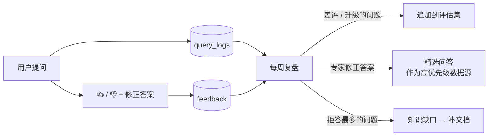

# 05 评估

> "改了一下 prompt，感觉好多了"——这句话在没有评估集的团队里每天都在说，而且经常是错的。
>
> 代码：`evaluation.py`；评估集：`eval/golden_qa.jsonl`；命令：`servicekb eval`

## 1. 评估什么

RAG 有两个环节可能出错，要分开评估：

```mermaid
flowchart LR
    Q[问题] --> R[检索] --> G[生成] --> A[答案]
    R -.->|检索指标<br/>证据找得对不对| M1[hit@k / recall / MRR / nDCG]
    G -.->|回答指标<br/>答得对不对| M2[关键事实召回 / 引用率 / 拒答准确率 / 忠实度]
```

**先看检索**：检索没找到正确证据，生成环节不可能答对。大多数"答错了"的问题，根源都在检索。

## 2. 评估集格式

```json
{"id": "q03", "question": "310-04521-A 还能订到吗？",
 "relevant": ["parts_master:310-04521-A", "parts_master:310-04521-B", "bulletins:SB-2025-014_fan_module_change.md"],
 "must_include": ["310-04521-B"],
 "answerable": true}
```

| 字段 | 含义 |
| --- | --- |
| `relevant` | 能回答这个问题的文档（`source_id:external_id`），文档级标注，不用标到块 |
| `must_include` | 正确答案里**必须出现**的关键事实：料号、数值、版本号。工业场景最实用的硬指标 |
| `answerable` | `false` = 知识库里没有答案，系统应该拒答 |
| `user_groups` | 可选，用指定权限提问（测试 ACL）|

## 3. 指标

### 检索（不需要 LLM，便宜、稳定，放进 CI）

| 指标 | 公式 | 直觉 |
| --- | --- | --- |
| Hit@k | 前 k 个结果里至少有一个相关文档 → 1，否则 0；取平均 | "能不能找到" |
| Recall@k | 前 k 个结果覆盖的相关文档数 / 相关文档总数 | "找得全不全" |
| MRR@k | 1 / 第一个相关文档的名次 | "排得靠不靠前" |
| nDCG@k | Σ 1/log₂(名次+1)，再除以理想排序的值 | 综合排序质量 |

检索结果是"块"，评估按"文档"算：同一文档的多个块只算第一次出现的位置。

### 回答

| 指标 | 怎么算 | 需要 LLM 裁判？ |
| --- | --- | --- |
| 关键事实召回（must_include） | 答案里包含的 must_include 项 / 总数 | 否 |
| 引用率 | 有有效引用的回答 / 所有非拒答回答 | 否 |
| 拒答准确率 | 该拒答的拒答了 + 不该拒答的没拒答 | 否 |
| 忠实度（Faithfulness） | 答案里每个陈述是否能被证据支持 | **是**（路线图）|
| 答案正确性 | 与参考答案对比 | **是**（路线图）|

ragas 里 `IDBasedContextPrecision` / `IDBasedContextRecall` 和本项目的检索指标思路相同（基于 ID、不需要 LLM）；`Faithfulness`、`FactualCorrectness` 等需要 LLM 裁判。

## 4. 运行

```bash
servicekb eval                                  # 默认 k=5，报告写到 eval/reports/
servicekb eval --k 10 --out /tmp/eval
servicekb eval --min-hit 0.85 --min-refusal 0.9 # 低于门槛返回非零退出码（CI 用）
```

报告（`eval_report.md`）包括汇总指标和每个问题的明细：是否命中、第一个相关文档排第几、拒答是否正确。`eval_report.json` 里还有每个问题检索到的文档和完整答案，方便逐条排查。

## 5. 怎么构建真实评估集（最重要的一节）

示例评估集只有 18 题，只能证明链路是通的。上线前需要用**真实数据**构建：

1. **从历史工单里抽题**：按故障码 / 机型 / 问题类型分层抽 100~200 张已解决工单。问题用工单原文（真实用户怎么问就怎么写，**不要改写得很规范**），相关文档 = 工单本身 + 工程师认可的手册章节。
2. **专门加"难题"**：
   - 料号精确匹配（A/B 版本）、替代件、停产件；
   - 型号的各种写法（"AS110K"、"110K 那台"）；
   - 跨语言（英文问、中文资料）；
   - 需要结合两份文档的问题（通告 + 手册）。
3. **加"不该回答"的题**（约 10%）：超出范围的、知识库里确实没有的、需要实时数据的（"这台机器现在的发电量"）。
4. **让工程师审一遍**：每题标注 must_include（真正决定对错的那几个关键事实）。
5. **只增不删**：新发现的失败案例追加进去；不要删除"总是失败"的题来刷分。
6. **防泄漏**：评估题对应的工单如果也在知识库里，"命中工单本身"不难。可以额外建一个"留出集"：把一部分工单从知识库里拿掉，只用来评估。

## 6. CI 回归门禁

`.github/workflows/ci.yml` 最后一步：

```bash
servicekb eval --min-hit 0.85 --min-refusal 0.9
```

任何改动（切块参数、分词词典、prompt、融合权重）让检索变差，PR 直接失败。门槛按当前基线设置，效果提升后同步提高。

## 7. 线上闭环



每周看三张表（SQL 见 [03_database.md](03_database.md#9-运维-sql-速查)）：
- 差评 + 专家修正 → 加入评估集；修正答案可以作为"精选问答"数据源导入（借鉴 Dify 的 annotation reply）；
- 拒答 / 升级最多的问题 → 知识缺口，交给技术支持补文档；
- 被引用最多的文档 → 重点维护对象。

## 8. LLM 裁判（下一步）

规则指标覆盖不了"答案整体对不对"。接入 LLM 裁判的建议：

- 先在 50 题上**让人和 LLM 裁判同时打分**，确认二者一致率（> 85%）再大规模使用；
- 裁判用比生成更强的模型；prompt 要适配中文（ragas 有 `adapt_prompts`）；
- 只在抽样上跑（成本）；
- 重点指标：Faithfulness（防幻觉）、FactualCorrectness（与参考答案对比）。
