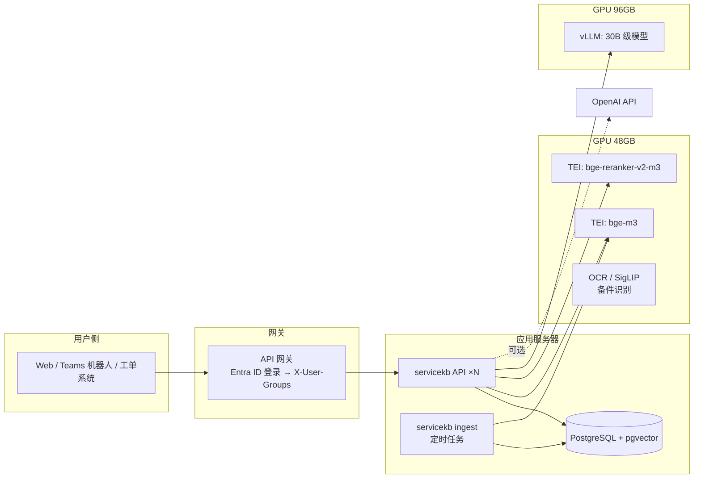

# 06 部署与运维

## 1. 部署形态



## 2. GPU 规划（48GB + 96GB 两台工作站）

| 卡 | 服务 | 显存占用（估算）| 说明 |
| --- | --- | --- | --- |
| 48GB | TEI bge-m3（568M 参数，fp16）| ~2~4 GB | 导入时批量编码，查询时单条编码 |
| 48GB | TEI bge-reranker-v2-m3（568M，fp16）| ~2~4 GB | 每次查询对 40 个候选打分 |
| 48GB | 余量 | ~40 GB | 留给 OCR、SigLIP 图像编码（备件识别）、docling / MinerU 解析 |
| 96GB | vLLM 30B 级模型（bf16 权重约 60 GB）| 约 85 GB（`gpu-memory-utilization 0.9`）| 剩余显存做 KV cache，支持并发和长上下文 |

也可以全部用 OpenAI API，只把 embedding / rerank 放本地（这两个模型小、调用频繁，本地部署更划算，而且导入时的文档内容不出公司）。

选择本地 LLM 时，在你们的评估集上比较几个候选模型，而不是只看公开榜单。注意模型许可证。

## 3. Docker Compose

```bash
cp .env.example .env               # 按"方案 B"修改
docker compose up -d db api        # 数据库 + API
docker compose --profile gpu up -d # GPU 服务
docker compose run --rm api servicekb db init
docker compose run --rm api servicekb ingest
curl localhost:8000/readyz
```

镜像版本已固定（`pgvector/pgvector:pg16`、`text-embeddings-inference:1.6`、`vllm-openai:v0.8.5`），升级前在测试环境验证。

> 说明：本仓库的 Docker 配置在编写时没有在 GPU 环境中实际启动验证过，首次部署请逐个服务检查日志。

## 4. 定时导入

导入是一次性任务，用 cron / systemd timer / K8s CronJob 定时运行：

```cron
# 每天凌晨 2:17 增量导入（SharePoint delta、工单导出、手册目录）
17 2 * * * cd /opt/servicekb && docker compose run --rm api servicekb ingest >> /var/log/servicekb-ingest.log 2>&1
```

- 同一个数据源不要并发导入。
- `ingest` 有失败文档时返回状态 `partial`（退出码 0），整体失败返回非零——监控退出码和 `ingestion_runs.status`。

## 5. 配置与密钥

- 所有配置走环境变量（`SERVICEKB_*`），密钥（数据库密码、`LLM_API_KEY`、`GRAPH_CLIENT_SECRET`）放密钥管理系统（Azure Key Vault 等），**不进 git、不进 sources.yaml**。
- `.env` 已在 `.gitignore` 里。

## 6. 安全清单

- [ ] `SERVICEKB_API_KEYS` 已设置（为空时 API 不鉴权，启动日志会告警）
- [ ] `X-User-Groups` 只由网关在用户登录后设置；外部请求带的这个头要在网关剥离
- [ ] 数据库不暴露公网；改掉默认密码；应用用最小权限账号
- [ ] 每个数据源的 `acl_groups` 经过业务确认（尤其是服务通告、工单这类内部资料）
- [ ] 入库前 PII 脱敏已开启；抽样检查过
- [ ] 发给外部 LLM 的内容经过法务评估（数据出境、DPA、不用于训练）
- [ ] prompt 注入：证据里的内容不会改变系统规则（prompt 规则 7）；不给 LLM 任何"执行操作"的工具权限
- [ ] 日志里不打印完整证据和用户问题之外的敏感字段；`query_logs` 有保留期限
- [ ] 容器以非 root 用户运行（Dockerfile 已处理）

## 7. 监控

| 指标 | 来源 | 告警建议 |
| --- | --- | --- |
| API 延迟 P50 / P95，按阶段 | `query_logs.timings_ms` | P95 > 8s |
| 拒答 / 升级率 | `query_logs.escalate` | 突然升高 → 检索或模型服务出问题 |
| 差评率 | `feedback` | 周环比上升 |
| 无引用回答比例 | `query_logs.citations` 为空且未拒答 | > 5% |
| 导入失败数 | `ingestion_runs` / `documents.status='failed'` | 任何整体失败；失败文档数持续增加 |
| 数据新鲜度 | `max(indexed_at)` per source | 超过 2 天没更新 |
| 降级次数 | 日志 `falling back` | 出现即关注 |

生产建议 `SERVICEKB_LOG_JSON=true`，日志输出为 JSON，方便 ELK / Loki 采集。

## 8. 故障处理手册

| 现象 | 排查 |
| --- | --- |
| 启动报 `IndexMismatchError` | 配置的向量模型和建库时不一致。要么改回原模型，要么 `db reset` 后重建 |
| 导入报 `refusing to delete N/M docs` | 数据源可能不完整（网盘没挂、导出被截断）。确认数据源正常后再决定是否 `--force-delete` |
| 某文档一直 `failed` | `SELECT error FROM documents WHERE status='failed'`；扫描件 → 换 docling；格式不支持 → 加解析器 |
| 回答全是"知识库中没有找到" | reranker 阈值太高 / reranker 服务异常 / 数据没导入（`servicekb db stats`）|
| 检索结果明显不相关 | 用 `servicekb search` 看三路排名；检查是否换过模型 |
| LLM 回答用的 `extractive-fallback` | LLM 服务超时或报错，看日志里的 `llm_error` |

## 9. 升级流程

1. 改代码 → PR → CI（lint、测试、评估门禁）
2. 改了清洗 / 切块逻辑：`PIPELINE_CODE_VERSION` +1，上线后跑一次 `ingest`（会全量重新处理，但向量复用）
3. 换向量模型：建新库 → 全量导入 → 评估 → 切换连接串（蓝绿），不要在原库上原地重建
4. 改 prompt：`PROMPT_VERSION` +1，评估对比，灰度上线，看差评率
