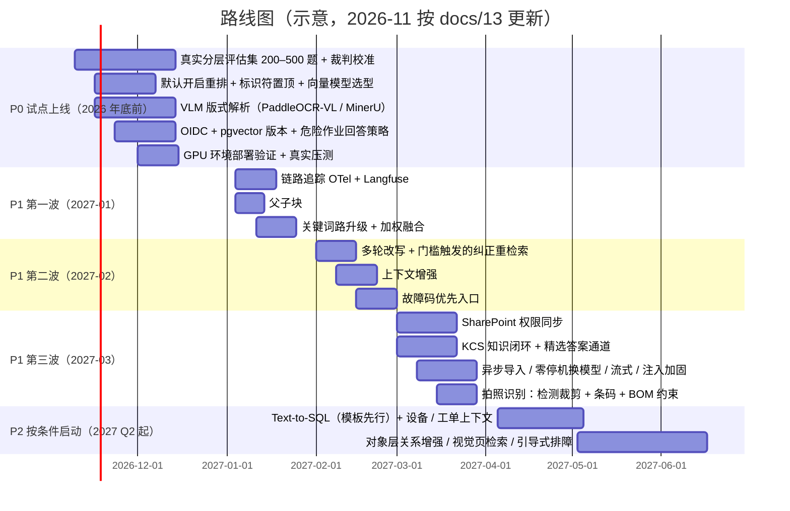
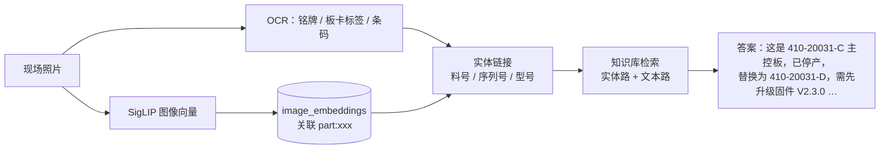

# 08 当前不足与改进路线图

> 诚实地写下现在做不到什么，比假装什么都能做更有用。优先级：**P0 上线前必须做 / P1 上线后 1~3 个月 / P2 视需求**。
>
> **2026-11 更新**：对照成熟开源项目和大厂托管服务做了一次横向对比（[docs/13](13_industry_comparison.md)），本文的优先级和路线图已按它调整。
> 优先级列里的 `P0-2`、`P1-4` 等编号对应 docs/13 第三、四节里的具体方案（依据、收益、成本、许可证、验证方法）。
> 总原则：**先补评估和解析地基，再逐项追平行业默认**；P1 一次只合入一项，过评估门禁再合下一项。

## 1. 当前不足

### 1.1 检索

| # | 不足 | 影响 | 优先级 |
| --- | --- | --- | --- |
| R1 | Postgres 关键词检索用 `ts_rank`，没有 IDF，不是真 BM25 | 关键词路排序质量下降（示例数据上差异很小，数据量大时会放大）| P1（P1-2，见 3.1）|
| R2 | 离线哈希向量无语义、不跨语言 | 只能用于 demo；q13（英文问中文资料）失败 | P0（生产换 bge-m3）|
| R3 | 没有查询改写 | 口语化、指代不清（"那台机器""上次那个问题"）的问题召回差；多轮对话不支持 | P1（P1-4）|
| R4 | 没有父子块 | 小块召回准但上下文少，大块上下文多但召回不准，现在只能折中 | P1（P1-1）|
| R5 | 近似去重只有字面（SimHash），没有语义去重 | 说法不同的重复工单不会被折叠 | P2 |
| R6 | 实体识别靠正则 + 别名表 | 没登记的新型号、新写法识别不了；中文零件名要 ≥ 4 字才匹配 | P1 |
| R7 | 时效性只靠 prompt 规则（"服务通告优先"）| 没有在排序里考虑文档日期和版本 | P1 |
| R8 | 重排默认关闭（`reranker_backend=none`），阈值没在真实数据上校准；标识符精确命中在 RRF 里只有"一票" | 公开评测里收益最大的一步没用上；语义相近的料号可能把正确料号挤下去 | **P0（P0-2）** |
| R9 | 没有上下文增强（每块只加了标题路径，没有 LLM 生成的定位说明） | 脱离上下文的块（"按上表操作"）召回差 | P1（P1-3）|

### 1.2 数据

| # | 不足 | 影响 | 优先级 |
| --- | --- | --- | --- |
| D1 | PDF 只支持文本层；表格靠 pypdf 抽文本，结构丢失 | 扫描件、复杂表格（参数表、故障码表）效果差 | **P0（P0-3：PaddleOCR-VL 为主、MinerU ≥ 3.1 对照、docling 兜底）** |
| D2 | 拍照识别只有骨架（[docs/10](10_part_photo_recognition.md)）：真实 SigLIP 未在真实照片上验证；没有目标检测、条码识别；手册里的接线图、故障屏截图还没用上 | 上线前必须用真实照片评估、校准阈值 | P0（真实照片进评估集）/ P1（P1-10：检测裁剪 + 条码 + BOM 约束）|
| D3 | SharePoint 文件权限没有自动同步 | 只能按数据源统一配置 ACL | P1（P1-6；如果试点内容的权限粒度细于"数据源级"，提前到 P0）|
| D4 | 导入是单进程同步执行 | 几万份 PDF 首次导入慢；没有进度、暂停、优先级队列 | P1（P1-9）|
| D5 | 维修记录、收货记录、现场记录等**结构化数据**没有接入 | 统计类问题答不了 | P2（P2-1，等数据接入；见 3.4）|
| D6 | 聊天群聊的会话切分只用时间间隔 | 话题交错的群聊会把不同问题混在一起 | P2 |
| D7 | 物料主数据质量问题只"报告"不"修复" | 需要人工处理重复建档、名称不统一 | P1（流程）|
| D8 | 没有知识闭环：专家修正、已关闭工单不会按 KCS 模板沉淀成审核过的知识；被拒答的问题不会变成"内容缺口" | 知识质量是行业公认的瓶颈 | P1（P1-7，见 3.6）|
| D9 | 只有自由文本问答，没有"故障码优先"入口（故障码 → 含义 → 常见原因 → 规程 → 备件），也不能直接粘贴设备事件日志 | 最高频的场景没有走确定性路径 | P1（P1-8）|
| D10 | 没有设备 / 工单上下文（按序列号、批次、固件取服务历史和适用通告） | 回答不针对具体那台设备 | P2（P2-2，等工单 / CRM 数据接入）|

### 1.3 生成与可信度

| # | 不足 | 影响 | 优先级 |
| --- | --- | --- | --- |
| G1 | 离线模式的拒答是启发式 | 换数据后阈值可能失效 | P0（生产开 reranker 并校准）|
| G6 | 离线抽取式回答只能摘原句 | 关键事实召回（0.857）低于检索命中率（0.938）| P0（生产接 LLM）|
| G2 | 引用只到块级 | 用户要自己在块里找依据；没法自动发现"引用了但其实不支持该结论" | P1 |
| G3 | 没有 LLM 裁判的忠实度评估 | 幻觉只能靠人工抽查发现 | **P0（P0-1：经人工校准的二元裁判）** |
| G4 | 不支持多轮对话 | 追问需要把上下文重新说一遍 | P1（P1-4，等前端上线后才有价值）|
| G5 | 没有流式输出 | 长答案等待时间长 | P1（P1-9）|
| G7 | 多厂家大模型只在 Mock 接口上测试过，没有对真实厂家跑过评估（token 用量记录、熔断已完成，见 [docs/12](12_production_hardening.md)）| 换厂家前不知道效果和成本 | P1（见 [docs/11](11_llm_providers.md#10-当前不足和改进方向)）|
| G8 | 危险作业（直流高压、储能热失控、上锁挂牌）没有专门的回答策略 | 只凭工单 / 聊天证据回答危险操作有安全风险；厂商都没有公开可参照的做法 | **P0（P0-4）** |
| G9 | 提示词注入防护只有"证据是数据不是指令"一条规则 | 系统没有工具调用，风险较低，但证据（工单、聊天）里可以夹带指令 | P1（P1-9：datamarking + 入库扫描 + CI 注入测试集）|

### 1.4 工程

| # | 不足 | 优先级 |
| --- | --- | --- |
| E1 | API 鉴权只有 API Key（已支持按调用方限制用户组）；用户身份依赖网关传入 | **P0（P0-4：直接校验 OIDC JWT）** |
| E2 | ~~没有 Prometheus 指标~~ ✅ 已有 `/metrics` + 请求 ID（[docs/12](12_production_hardening.md)）；还没有 OpenTelemetry 链路追踪 | P1（P1-5：OTel + Langfuse / Opik）|
| E3 | Docker / GPU 配置未在真实 GPU 环境验证 | P0 |
| E4 | 没有前端 | P1（Teams 机器人或简单 Web 页面）|
| E5 | 评估集只有 18 道虚构题：答对 15 道时 95% 置信区间约 61%–94%，只能发现灾难性回归 | **P0（P0-1：200–500 题真实分层评估集，含危险作业层和真实照片层）** |
| E6 | 没有流式输出、换向量模型需要停机重建、用户身份依赖网关传入（详见 [docs/12 §6](12_production_hardening.md#6-还没做的按优先级)） | P0 / P1 |
| E7 | 压测只在示例数据 + 单机上做过；真实 GPU 部署下的容量（p95、最大吞吐）未知 | P0（用 `scripts/loadtest.py` 在真实部署上测）|
| E8 | 没有约束 pgvector 的最低版本（0.8.3 修复了 HNSW 在 vacuum 时可能损坏索引的问题） | **P0（P0-4：≥ 0.8.3，`servicekb doctor` 加版本检查）** |
| E9 | 知识库没有通过 MCP 暴露给其他智能体（Copilot / Claude / Teams 智能体） | P2（P2-6：只读 search + fetch）|

## 2. 路线图总览

**为什么是这个顺序**（详见 [docs/13 第三、四节](13_industry_comparison.md#三p02026-年底前可测量读得懂文档默认就准)）：

- **评估集排第一**：后面每一项改进都要靠它验收。18 道题只能发现灾难性回归，几百题才能检出 5~10 个点的变化。
- **重排和解析紧随其后**：重排是公开评测里收益最大的单步，而且代码已经有了；手册里最常被问的故障码表、参数表恰恰是 pypdf 丢结构的地方。
- **P1 分波、一次一项**：同时改好几处，回归会互相掩盖。追踪先上，之后每个 A/B 的效果才能归因。
- **P2 等数据和失败证据**：Text-to-SQL、设备上下文要等工单 / CRM 数据接入；图谱、视觉页检索要等评估集出现对应的失败再做，而不是因为"别人都有"。

## 3. 关键改进的设计草图

### 3.1 真 BM25 / 学习型稀疏向量（R1）

三个方案（2026-11 调研更新，详见 [docs/13 P1-2](13_industry_comparison.md#p12027-年一季度十项改进分三波上线每项单独过门禁)），建议先做 A：

- **A：BGE-M3 稀疏向量**。bge-m3 一次编码同时输出稠密向量和词权重（`lexical_weights`）。存进 pgvector 的 `sparsevec` 列（HNSW 索引最多 1,000 个非零元素），作为第四路加进融合。优点：多语言、不需要分词器、权重是学出来的；BGE-M3 论文里中文 BM25 本来就弱（MIRACL 中文 nDCG@10 只有 17.5）；不需要升级 Postgres。如果 P0-2 的向量模型选型选了 bge-m3，这一路几乎是免费的；选了 Qwen3 系，就要额外跑一遍 bge-m3 编码。新增迁移 `004_sparse.sql`。
- **B：pg_textsearch**（Tiger Data，PostgreSQL License，v1.0 起 GA）。真 BM25（Block-Max WAND，可调 k1 / b），支持直接索引 `text[]`——可以把 Python 侧已有的 jieba 词元原样建索引，保住自定义词典和料号处理逻辑。代价：只支持 PG 17 / 18，而 [docker-compose.yml](../docker-compose.yml) 用的是 pg16 镜像，要和数据库大版本升级一起排期。
- **C：ParadeDB `pg_search`**（Tantivy BM25 + jieba 分词器，功能最全）。AGPL-3.0，只在法务同意时考虑。

无论选哪个，**精确标识符仍由实体路负责**：分词器怎么切 `310-04521-B` 这种带连字符的料号，各家都没有文档说明，上线前必须实测；Milvus 的中文分析器甚至会直接丢掉含非中文字符的词元。融合时给三路设权重（在评估集上调），实体路精确命中时置顶（P0-2）。

### 3.2 父子块 + 查询改写（R3、R4）

- **父子块**（QAnything / RAGFlow）：检索 200~400 token 的子块，送给 LLM 的是它所属的 800~1000 token 父块（或整个小节）。`chunks` 加 `parent_id`，`chunks_for_documents` 已经能按文档取块，改动不大。
- **查询改写**：用小模型把口语化问题改写成"型号 + 故障码 + 现象"的检索式，并生成 2~3 个变体（multi-query）；多轮对话时把上文压缩进问题。改写结果和原问题一起检索，RRF 融合。
  - 2026-11 调研补充：多轮改写的独立证据最强（IBM MTRAG-UN：Recall@5 +7~9 个点）；改写要**继承实体槽位**（型号、料号、故障码），缺关键槽位时反问用户；
    查询里有规范标识符时**关闭 HyDE / multi-query**（独立研究显示 HyDE 对精确查询有害，改写还可能篡改料号）。
  - **证据门槛当路由器**：门槛通过 → 直接回答；不通过 → 改写 / 分解后做一次纠正式重检索（CRAG 式，独立复现 +3 个点）；仍不通过 → 拒答升级并生成内容缺口工单。

### 3.3 图片：与备件识别打通（D2）

> ✅ 骨架已实现：照片 → OCR + 外观匹配 + 融合 → 对象层 → 知识库，见 [docs/10](10_part_photo_recognition.md)。下面是最初的设计草图，剩余工作见 docs/10 第 12 节。

售后场景里"拍照识别备件"是常见需求（典型做法：能读到料号的直接查物料表，电气件识别板卡标签 / 条码，结构件比对图纸，外观用图像向量模型如 SigLIP 做相似检索）。和知识库打通：

- 新表 `image_embeddings(image_id, entity_id, embedding vector(d), source, …)`，和文本块共用一个 Postgres。
- 识别出的料号直接作为查询实体，复用现有的替代件扩展和结构化事实。
- 高分辨率现场照片直接缩放到图像模型的输入尺寸（SigLIP 常见权重为 224~512 px）会丢失小字，需要先检测 / 裁剪零件区域或切块编码。
- 手册里的图片（接线图、爆炸图）：docling / MinerU 能抽出图片和题注，题注 + 周边文字进文本索引，图片进图像索引。

### 3.4 结构化问题：Text-to-SQL 路由（D5）

"AS-110K-HV 去年 E037 报了多少次""哪个服务商的返修率最高"——这类统计问题不是 RAG 擅长的，应该查数据库：

1. 把维修记录、收货记录、现场记录整理成**按对象建模**的表（设备、零件、服务商、工单），用对象层的 ID 关联；
2. 加一个**路由**：先判断问题是"查知识"还是"查数据"（规则 + 小模型分类）；
3. "查数据"走 Text-to-SQL：只读账号、只开放视图、限制返回行数、SQL 先过白名单检查再执行，结果和生成的 SQL 一起展示给用户。

2026-11 调研补充（[docs/13 P2-1](13_industry_comparison.md#p22027-年二季度起等工单数据接入或评估出现对应失败时再启动)）：**模板先行**——先把高频统计做成参数化查询模板（作为工具调用），自由形式 SQL 只兜底长尾；
硬边界靠数据库（只读角色、行级安全、`statement_timeout`、`LIMIT`），sqlglot 解析后只放行 SELECT、解析不了的一律拒绝，用户身份过滤由服务端注入——提示词里的"不要删数据"不是安全控制。
语义层（指标 / 维度定义）在独立研究里带来 +17~23 个百分点；公开基准（BIRD、Spider 2.0）标注错误率超过 50%，排行榜数字参考价值有限。

### 3.5 句子级引用校验（G2）

借鉴 kotaemon：要求 LLM 对每个 [n] 给出逐字引用的短语，后处理在证据块里模糊匹配（中文按字符长度，不按"6 个词"）。匹配不上的引用标记为"未验证"，可以在前端用不同颜色显示。也可以用小模型做 NLI（证据是否蕴含该句）。

### 3.6 精选问答（来自反馈）

借鉴 Dify annotation reply：专家在 `feedback.corrected_answer` 里修正过的答案，定期导出成一个 `curated_qa` 数据源（`qa_archive` connector 即可读取），在检索里给更高权重，或者问题高度相似时直接返回。

### 3.7 对象层 → 知识图谱（P2）

现在的对象层（实体表 + 关系表）已经是图的雏形。什么时候升级？**评估集里出现多跳失败时**（例如"用了 410-20031-D 主控板的机器，常见的连带故障有哪些"）。

2026-11 调研结论（[docs/13](13_industry_comparison.md#图谱与-agentic图谱方法只在多跳题上领先约-10-分单跳持平或更差)）：三项独立评测一致显示，图谱方法只在多跳 / 复杂推理题上领先（约 +10 分），**单跳事实题上持平或更差**，
而 LightRAG 每题约 10 万 token、GraphRAG 全局检索更贵。所以先做**轻量版**：规范节点只来自对象层，加上不消耗 token 的实体共现边，
从查询实体出发做个性化 PageRank 或 1~2 跳扩展（HippoRAG / LazyGraphRAG 的思路）；下面的 LLM 关系抽取只在轻量版不够用时再做。做法：

- 只对工单、维修记录、服务通告做 LLM 关系抽取，且限定在**封闭的关系 schema** 内（实体类型 Product / Part / FaultCode / Firmware / Symptom / Action，gleaning=1，缓存结果）；
- 每条抽取出来的边记录来源块、可信度和有效期；**人工维护的替代 / 停产关系优先**，抽取结果不能覆盖它们；
- **每个抽取出来的名字都必须解析到对象层的规范 ID**（避免 LightRAG 按名字合并导致的实体分裂）；
- 边记录来源块 ID，删除文档时可以重建；
- 图存在同一个 Postgres（关系表 + 递归 CTE，或 Apache AGE）；
- GraphRAG 的社区报告只用于离线的"主题分析"（反复出现的故障模式），定期全量重建。

### 3.8 业务 Agent（P2）

售后的业务面通常很宽：质保、服务商派单与验收、预防性维护等。知识库是这些流程的"知识底座"，Agent 在上面编排：

- **现场照片验收**：服务商提交的现场照片 → 图像质量检查 + OCR 识别序列号 / 料号 → 和工单要求比对 → 不合格自动退回并说明原因；
- **派单辅助**：根据故障码、机型、历史维修记录推荐备件清单和服务商；
- **预防性维护**：基于维修记录统计（Text-to-SQL）+ 手册保养周期，生成维护计划。

原则：Agent 的每一步都可审计；涉及钱、安全、对外通知的操作必须人工确认；LLM 只能调用明确授权的只读工具，写操作走审批。

## 4. 不打算做的事

- **不自己训练 / 微调大模型来"记住知识"**：知识会变、无法引用、成本高。微调只考虑在"改写查询"、"抽取问答"这类格式化任务上用小模型。
- **不做通用的 LLM 应用平台**：需要可视化编排时，直接用 Dify 之类的平台调用本项目的 API。

2026-11 横向对比后补充的"现在不做"清单（理由和"何时重新考虑"见 [docs/13 第五节](13_industry_comparison.md#现在不做的十件事多数在单跳事实题上没有收益成本却高一个数量级)）：

- **不迁移到 RAGFlow / Dify / FastGPT / Onyx 等平台**：不可逆升级、许可证限制，对象层和标识符通道在平台上很难深度定制；
- **不更换 / 新增检索引擎**（Milvus、ES、Vespa、Qdrant、VectorChord……）：10^5~10^7 块的规模 pgvector + halfvec 足够；
- **不上完整的 GraphRAG / LightRAG**、**不做 ColBERT 首阶段索引**、**不默认开启多智能体深度研究**：单跳题没有收益，成本高一到两个数量级；
- **不对标识符查询做 HyDE / 无条件 multi-query**，**不做语义答案缓存**（越权泄露风险；型号 / 固件不同的相似问题会命中错误答案），**不做自由形式 Text-to-SQL**；
- **不用成对胜率式 LLM 裁判做验收**，不把 RAGAS 当硬依赖；
- **不引入受限许可证的组件**：AGPL / GPL / 非商用 / 企业版代码（例如 Onyx `ee/`、MaxKB、MinerU 3.1.0 之前的版本、jina 非商用模型），除非法务书面确认。

**护城河提醒**：本项目和通用平台最大的区别是对象层和标识符通道。引入任何"行业默认"组件（分词器、重排器、改写器、解析器）时，
**评估集里的标识符切片（hit@1）不得下降**，这是每次合入的一票否决项。
