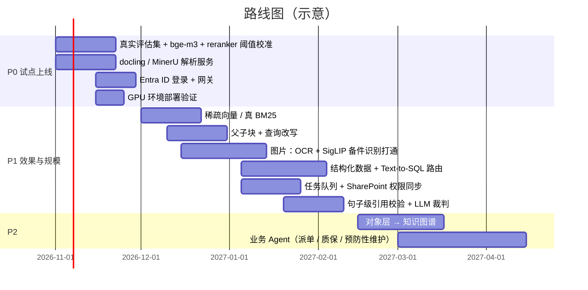
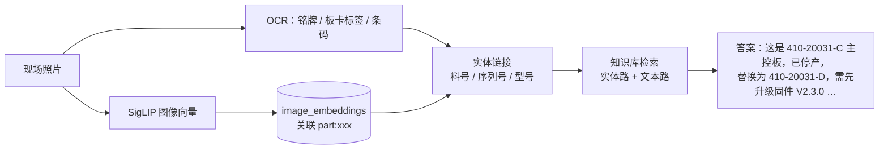

# 08 当前不足与改进路线图

> 诚实地写下现在做不到什么，比假装什么都能做更有用。优先级：**P0 上线前必须做 / P1 上线后 1~3 个月 / P2 视需求**。

## 1. 当前不足

### 1.1 检索

| # | 不足 | 影响 | 优先级 |
| --- | --- | --- | --- |
| R1 | Postgres 关键词检索用 `ts_rank`，没有 IDF，不是真 BM25 | 关键词路排序质量下降（示例数据上差异很小，数据量大时会放大）| P1 |
| R2 | 离线哈希向量无语义、不跨语言 | 只能用于 demo；q13（英文问中文资料）失败 | P0（生产换 bge-m3）|
| R3 | 没有查询改写 | 口语化、指代不清（"那台机器""上次那个问题"）的问题召回差；多轮对话不支持 | P1 |
| R4 | 没有父子块 | 小块召回准但上下文少，大块上下文多但召回不准，现在只能折中 | P1 |
| R5 | 近似去重只有字面（SimHash），没有语义去重 | 说法不同的重复工单不会被折叠 | P2 |
| R6 | 实体识别靠正则 + 别名表 | 没登记的新型号、新写法识别不了；中文零件名要 ≥ 4 字才匹配 | P1 |
| R7 | 时效性只靠 prompt 规则（"服务通告优先"）| 没有在排序里考虑文档日期和版本 | P1 |

### 1.2 数据

| # | 不足 | 影响 | 优先级 |
| --- | --- | --- | --- |
| D1 | PDF 只支持文本层；表格靠 pypdf 抽文本，结构丢失 | 扫描件、复杂表格（参数表、故障码表）效果差 | P0（接 docling / MinerU）|
| D2 | 没有图片能力 | 现场照片、铭牌、故障屏截图、手册里的接线图都用不上 | P1 |
| D3 | SharePoint 文件权限没有自动同步 | 只能按数据源统一配置 ACL | P1 |
| D4 | 导入是单进程同步执行 | 几万份 PDF 首次导入慢；没有进度、暂停、优先级队列 | P1 |
| D5 | 维修记录、收货记录、现场记录等**结构化数据**没有接入 | 统计类问题答不了 | P1（见 3.4）|
| D6 | 聊天群聊的会话切分只用时间间隔 | 话题交错的群聊会把不同问题混在一起 | P2 |
| D7 | 物料主数据质量问题只"报告"不"修复" | 需要人工处理重复建档、名称不统一 | P1（流程）|

### 1.3 生成与可信度

| # | 不足 | 影响 | 优先级 |
| --- | --- | --- | --- |
| G1 | 离线模式的拒答是启发式 | 换数据后阈值可能失效 | P0（生产开 reranker 并校准）|
| G6 | 离线抽取式回答只能摘原句 | 关键事实召回（0.857）低于检索命中率（0.938）| P0（生产接 LLM）|
| G2 | 引用只到块级 | 用户要自己在块里找依据；没法自动发现"引用了但其实不支持该结论" | P1 |
| G3 | 没有 LLM 裁判的忠实度评估 | 幻觉只能靠人工抽查发现 | P1 |
| G4 | 不支持多轮对话 | 追问需要把上下文重新说一遍 | P2 |
| G5 | 没有流式输出 | 长答案等待时间长 | P2 |

### 1.4 工程

| # | 不足 | 优先级 |
| --- | --- | --- |
| E1 | API 鉴权只有 API Key；用户身份依赖网关传入 | P0（接 Entra ID / OIDC）|
| E2 | 没有 OpenTelemetry 链路追踪、Prometheus 指标 | P1 |
| E3 | Docker / GPU 配置未在真实 GPU 环境验证 | P0 |
| E4 | 没有前端 | P1（Teams 机器人或简单 Web 页面）|
| E5 | 评估集只有 18 道虚构题 | P0（用真实工单建 100~200 题）|

## 2. 路线图总览

## 3. 关键改进的设计草图

### 3.1 真 BM25 / 学习型稀疏向量（R1）

两个方案，建议先做 A：

- **A：BGE-M3 稀疏向量**。bge-m3 一次编码同时输出稠密向量和词权重（`lexical_weights`）。存进 pgvector（≥ 0.7）的 `sparsevec` 列，建 HNSW 索引（`sparsevec_ip_ops`，非零元素截断到 1000 以内）。优点：多语言、不需要分词器、权重是学出来的；作为第四路加进 RRF 即可。需要升级 pgvector 并新增迁移 `002_sparse.sql`。
- **B：ParadeDB `pg_search`**（Tantivy BM25 + jieba 分词器）。真 BM25，但 AGPL-3.0，需要法务确认。

### 3.2 父子块 + 查询改写（R3、R4）

- **父子块**（QAnything / RAGFlow）：检索 200~400 token 的子块，送给 LLM 的是它所属的 800~1000 token 父块（或整个小节）。`chunks` 加 `parent_id`，`chunks_for_documents` 已经能按文档取块，改动不大。
- **查询改写**：用小模型把口语化问题改写成"型号 + 故障码 + 现象"的检索式，并生成 2~3 个变体（multi-query）；多轮对话时把上文压缩进问题。改写结果和原问题一起检索，RRF 融合。

### 3.3 图片：与备件识别打通（D2）

售后场景里"拍照识别备件"是常见需求（典型做法：能读到料号的直接查物料表，电气件识别板卡标签 / 条码，结构件比对图纸，外观用图像向量模型如 SigLIP 做相似检索）。和知识库打通：

- 新表 `image_embeddings(image_id, entity_id, embedding vector(d), source, …)`，和文本块共用一个 Postgres。
- 识别出的料号直接作为查询实体，复用现有的替代件扩展和结构化事实。
- 高分辨率现场照片直接缩放到图像模型的输入尺寸（SigLIP 常见权重为 224~512 px）会丢失小字，需要先检测 / 裁剪零件区域或切块编码。
- 手册里的图片（接线图、爆炸图）：docling / MinerU 能抽出图片和题注，题注 + 周边文字进文本索引，图片进图像索引。

### 3.4 结构化问题：Text-to-SQL 路由（D5）

"AS-110K-HV 去年 E037 报了多少次""哪个服务商的返修率最高"——这类统计问题不是 RAG 擅长的，应该查数据库：

1. 把维修记录、收货记录、现场记录整理成**按对象建模**的表（设备、零件、服务商、工单），用对象层的 ID 关联；
2. 加一个**路由**：先判断问题是"查知识"还是"查数据"（规则 + 小模型分类）；
3. "查数据"走 Text-to-SQL：只读账号、只开放视图、限制返回行数、SQL 先过白名单检查再执行，结果和生成的 SQL 一起展示给用户。

### 3.5 句子级引用校验（G2）

借鉴 kotaemon：要求 LLM 对每个 [n] 给出逐字引用的短语，后处理在证据块里模糊匹配（中文按字符长度，不按"6 个词"）。匹配不上的引用标记为"未验证"，可以在前端用不同颜色显示。也可以用小模型做 NLI（证据是否蕴含该句）。

### 3.6 精选问答（来自反馈）

借鉴 Dify annotation reply：专家在 `feedback.corrected_answer` 里修正过的答案，定期导出成一个 `curated_qa` 数据源（`qa_archive` connector 即可读取），在检索里给更高权重，或者问题高度相似时直接返回。

### 3.7 对象层 → 知识图谱（P2）

现在的对象层（实体表 + 关系表）已经是图的雏形。什么时候升级？**评估集里出现多跳失败时**（例如"用了 410-20031-D 主控板的机器，常见的连带故障有哪些"）。做法：

- 只对工单和维修记录做 LLM 关系抽取（LightRAG 的 prompt 格式，实体类型换成 Product / Part / FaultCode / Firmware / Symptom / Action，gleaning=1，缓存结果）；
- **每个抽取出来的名字都必须解析到对象层的规范 ID**（避免 LightRAG 按名字合并导致的实体分裂）；
- 边记录来源块 ID，删除文档时可以重建；
- 图存在同一个 Postgres（关系表 + 递归 CTE，或 Apache AGE）；
- GraphRAG 的社区报告只用于离线的"主题分析"（反复出现的故障模式），定期全量重建。

### 3.8 业务 Agent（P2）

售后的业务面通常很宽：质保、服务商派单与验收、预防性维护等。知识库是这些流程的"知识底座"，Agent 在上面编排：

- **现场照片验收**：服务商提交的现场照片 → 图像质量检查 + OCR 识别序列号 / 料号 → 和工单要求比对 → 不合格自动退回并说明原因；
- **派单辅助**：根据故障码、机型、历史维修记录推荐备件清单和服务商；
- **预防性维护**：基于维修记录统计（Text-to-SQL）+ 手册保养周期，生成维护计划。

原则：Agent 的每一步都可审计；涉及钱、安全、对外通知的操作必须人工确认；LLM 只能调用明确授权的只读工具，写操作走审批。

## 4. 不打算做的事

- **不自己训练 / 微调大模型来"记住知识"**：知识会变、无法引用、成本高。微调只考虑在"改写查询"、"抽取问答"这类格式化任务上用小模型。
- **不做通用的 LLM 应用平台**：需要可视化编排时，直接用 Dify 之类的平台调用本项目的 API。
