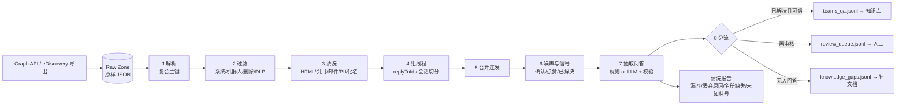
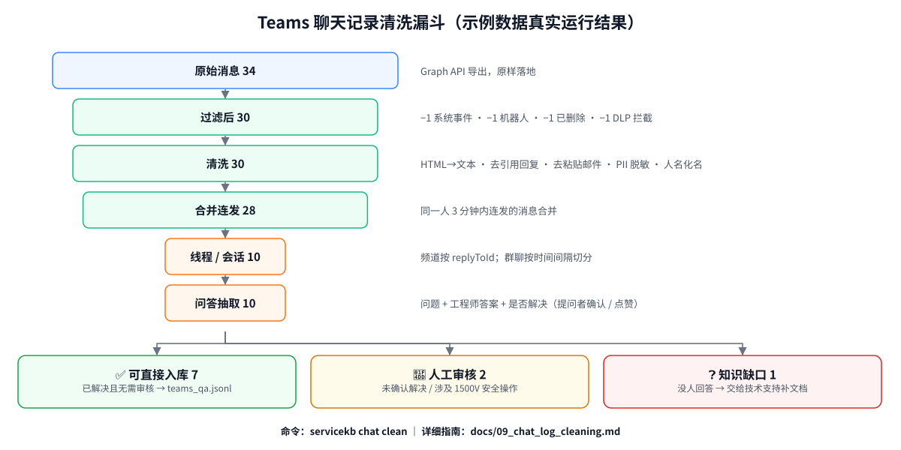

# 09 企业聊天记录（Teams）清洗指南

> 目标：把从 Teams（也适用于 Slack、企业微信）收集来的、非常"脏"的技术支持聊天记录，变成**可检索、可引用、可信**的问答知识，并且全程合规。
>
> 配套代码：`src/servicekb/chat/`，命令：`servicekb chat clean`。示例数据：`data/sample/chat/`（虚构）。
>
> 本文的 Graph API 细节于 2026-10 对照微软官方文档源仓库 [microsoftgraph/microsoft-graph-docs-contrib](https://github.com/microsoftgraph/microsoft-graph-docs-contrib) 核对过。微软的 API、许可和限流政策变化很快，**上线前请再核对一次**。文中标 ⚠️ 的是未能完全确认的点。

---

## 目录

1. [为什么聊天记录特别难清洗](#1-为什么聊天记录特别难清洗)
2. [总体流程](#2-总体流程)
3. [第 0 步：先定规矩（合规与范围）](#3-第-0-步先定规矩合规与范围)
4. [第 1 步：获取数据](#4-第-1-步获取数据)
5. [第 2 步：原样落地](#5-第-2-步原样落地raw-zone)
6. [第 3 步：消息级过滤](#6-第-3-步消息级过滤)
7. [第 4 步：内容清洗](#7-第-4-步内容清洗)
8. [第 5 步：重建对话结构](#8-第-5-步重建对话结构)
9. [第 6 步：识别噪声与"已解决"信号](#9-第-6-步识别噪声与已解决信号)
10. [第 7 步：抽取问答对](#10-第-7-步抽取问答对)
11. [第 8 步：去重](#11-第-8-步去重)
12. [第 9 步：分流、入库、增量更新](#12-第-9-步分流入库增量更新)
13. [第 10 步：质量评估](#13-第-10-步质量评估)
14. [工具清单](#14-工具清单)
15. [在本项目里跑一遍](#15-在本项目里跑一遍)
16. [上线检查清单](#16-上线检查清单)

---

## 1. 为什么聊天记录特别难清洗

工单天然是"一问一答"；聊天记录是一条**消息流**。下面每一种"脏"，如果不处理，都会直接伤害 RAG：

| 脏数据 | 例子 | 不处理的后果 |
| --- | --- | --- |
| 系统消息 | "张三加入了频道"、会议开始/结束 | 检索结果里全是无意义内容 |
| 机器人 / 连接器推送 | 工单机器人每天发"今日新增 12 单" | 同上，而且量很大 |
| 已删除、被 DLP 拦截的消息 | 撤回的消息、含银行卡号被拦截的消息 | **合规事故**：用户撤回的内容被永久存进知识库 |
| HTML 标记 | `<at id="0">王工</at>`、`<attachment id=…>`、`<emoji>` | 分词、向量都被 HTML 污染 |
| 引用回复 | 回复时自动带上被回复消息的预览 | 同一段话出现 N 次，挤占 top-k |
| 粘贴的邮件 | 把整封邮件（含 From/Sent/历史引用）贴进聊天 | 大段噪声 + 客户邮箱泄露 |
| 碎片化 | 一句话分三条发："E037" "早上出现" "中午好了" | 单条消息没有完整语义，切块后检索不到 |
| 确认类消息 | "收到""👍""thanks" | 没有知识价值，但**是判断"问题是否解决"的关键信号** |
| 话题交错 | 群聊里两个问题同时在讨论 | 问题 A 的答案被配给问题 B |
| 非专家的错误回答 | 现场同事："好像是 3 N·m 吧"（正确是 2.5） | **把错误答案当成知识**，最危险 |
| 无结论 | 问了没人回，或者聊着聊着就没下文 | LLM 拿"未解决的讨论"当证据，答非所问 |
| 个人信息 | 姓名、手机号、客户邮箱 | 隐私合规风险，尤其是发给外部 LLM API |
| 时效性 | 2024 年说"用 310-04521-A"，2025 年该料号停产 | 推荐已停产的零件 |

**核心认知：聊天记录不能直接切块入库。** 正确做法是把它**提炼成问答对**（和工单同样的结构），再走知识库的标准入库流程。原始对话只作为"证据出处"保留链接。

---

## 2. 总体流程



用示例数据实际跑一遍的漏斗：



每个阶段丢掉了什么、为什么丢，都要**计数并写进报告**。清洗是"有损"的，没有报告就无法和业务方对账，也无法发现规则误伤。

---

## 3. 第 0 步：先定规矩（合规与范围）

**这一步不做，后面做得再好也可能要全部删掉。** 员工聊天记录属于敏感数据，涉及隐私、劳动法和数据出境。

### 3.1 必须拿到的批准

- 法务、HR、信息安全、隐私（DPO）的书面同意；欧洲子公司可能还需要劳资委员会（works council）。
- 做一次 DPIA（数据保护影响评估），写清楚：采集什么、为什么、保存多久、谁能看、是否发送给第三方（LLM API）。
- 如果涉及中国境内员工 / 客户的个人信息发往境外 LLM API，请法务评估 **PIPL（个人信息保护法）跨境传输**要求。

### 3.2 范围：只采"指定的技术支持频道"

| 做法 | 推荐 | 原因 |
| --- | --- | --- |
| 只采集若干个**明确公告过用途**的技术支持频道 | ✅ | 员工知情，内容本来就是工作讨论 |
| 用资源级授权（RSC）`ChannelMessage.Read.Group`，由 Team owner 逐个授权 | ✅ | 应用只能读被授权的 Team |
| 租户级 `ChannelMessage.Read.All` | ⚠️ 尽量不用 | 能读全公司所有频道，权限过大 |
| `Chat.Read.All` 采集 1:1 / 群聊 | ❌ 不建议 | 覆盖所有私聊，几乎不可能通过合规审批 |

在频道里发一条置顶公告："本频道的已解决问答会被整理进售后知识库"，并给出退出 / 申请删除的方式。

### 3.3 保留期限与法律保全

- 你复制出来的数据**不受 Teams 原有保留策略管理**：Teams 里删了，你这里还在。所以必须**同步删除和编辑**（见第 12 节）。
- 复制件在诉讼中同样可能被调取（discoverable），保存期限要和法务约定。
- `policyViolation` 不为空的消息（被 DLP 拦截）一律不采。

### 3.4 权限继承

知识库里的每条问答都要带上**原频道的可见范围**，否则私有频道的内容会被所有人检索到：

- 标准频道：可见范围 = Team 成员
- 私有 / 共享频道：可见范围 = 频道成员（`GET /teams/{team-id}/channels/{channel-id}/members`，权限 `ChannelMember.Read.Group` 或 `ChannelMember.Read.All`）

本项目里通过 `ChatCleaningConfig.acl_by_conversation` 把"对话 → 用户组"映射写进输出，再由 `qa_archive` connector 的 `allow_row_acl: true` 读入。

### 3.5 发送给外部 LLM

- **先脱敏再发送**（本流程的第 3 步在第 7 步 LLM 抽取之前）。
- 和供应商签 DPA：不用于训练、数据保留期限、处理区域。
- 能用本地模型（96GB 卡上的 vLLM）就用本地模型做抽取。

---

## 4. 第 1 步：获取数据

### 4.1 方案对比

| 方案 | 适合 | 优点 | 缺点 |
| --- | --- | --- | --- |
| **Microsoft Graph API**（推荐） | 持续、自动化的知识沉淀 | 结构化 JSON（线程、@提及、点赞、附件都在）；可增量 | 要注册应用、申请权限；有限流 |
| Microsoft Purview eDiscovery 导出 | 一次性、合规驱动的导出 | 法律上可辩护；包含保留 / 已删除内容；不用注册应用 | 手工、按案件导出；结构被拍平（PST/.msg/HTML 转录），@提及和点赞等字段丢失，需要再解析 HTML |
| 浏览器插件 / 网页抓取 | ❌ 不要用 | — | 使用内部接口，违反服务条款，无法通过合规审计 |

### 4.2 Graph API 端点（v1.0）

| 用途 | 端点 | 说明 |
| --- | --- | --- |
| 频道根消息 | `GET /teams/{team-id}/channels/{channel-id}/messages` | 只返回根消息；`$top` 默认 20、最大 50；可 `$expand=replies` |
| 某条消息的回复 | `GET /teams/{team-id}/channels/{channel-id}/messages/{message-id}/replies` | `$top` 最大 50 |
| 频道批量导出 | `GET /teams/{team-id}/channels/getAllMessages` | **仅应用权限**；覆盖公开和私有频道；回复"平铺"返回，带 `replyToId` |
| 聊天消息 | `GET /chats/{chat-id}/messages` | `$orderby` 只支持 `lastModifiedDateTime` / `createdDateTime` 降序 |
| 用户所有聊天导出 | `GET /users/{id}/chats/getAllMessages` | 权限 `Chat.Read.All`，**范围过大，不建议** |
| 聊天增量 | `GET /users/{id}/chats/getAllMessages/delta` | 文档写明只返回**最近 8 个月**的消息 |
| 消息内嵌图片 | `GET …/messages/{message-id}/hostedContents/{id}/$value` | 需要 OCR / 多模态时才下载 |
| 频道成员（ACL） | `GET /teams/{team-id}/channels/{channel-id}/members` | 用于权限继承 |

⚠️ **频道消息的 delta**（`/teams/{id}/channels/{id}/messages/delta`）在旧版文档和 Graph PowerShell 里存在，但当前文档源里已找不到，依赖它之前请先实测。稳妥做法：按 `lastModifiedDateTime` 定期全量拉取指定频道（频道数量少时完全可行）。

### 4.3 权限（最小权限优先）

| 场景 | 应用权限（Application） |
| --- | --- |
| 读指定 Team 的频道消息 | `ChannelMessage.Read.Group`（RSC，Team owner 授权）✅ |
| 读所有频道消息 | `ChannelMessage.Read.All`（需管理员同意）|
| 读聊天 | `ChatMessage.Read.Chat`（RSC）/ `Chat.Read.All` |
| 读频道成员 | `ChannelMember.Read.Group` / `ChannelMember.Read.All` |

### 4.4 许可与"受保护 API"

- 微软文档（metered-api-list）写明：**自 2025-08-25 起，Teams API 不再计量收费**，无需配置计费。早年的 `model=A` / `model=B` 许可模式可视为历史。
- ⚠️ `getAllMessages` 等属于"受保护 API"，文档仍写着需要提交申请表；也有第三方说申请表已取消。**实测最可靠**：调用返回 403 说明还需要申请。

### 4.5 限流

| 接口 | 限制 |
| --- | --- |
| GET 频道消息 / 聊天消息 | 每应用 200 rps；**每应用每租户 20 rps**；**每个频道 / 聊天 1 rps** |
| getAllMessages 系列 | 每应用 1000 rps；每应用每租户 200 rps |

- 被限流时返回 **429 + `Retry-After`**，必须等待指定秒数；没有该头时用指数退避。（本项目 `GraphClient.get` 已实现）
- 微软 Teams API 指南要求：同一资源**轮询频率不超过每天一次**，更高频率请用 change notifications（webhook 订阅）。对知识库来说每天同步一次完全够用。

### 4.6 本项目的导出器

```bash
export SERVICEKB_GRAPH_TENANT_ID=...
export SERVICEKB_GRAPH_CLIENT_ID=...
export SERVICEKB_GRAPH_CLIENT_SECRET=...
servicekb chat export --team-id <team-id> --channel-id <channel-id> --out raw/teams_support.jsonl
```

实现在 `src/servicekb/chat/teams_source.py`：先分页拉根消息，再逐条拉回复，**原样**写成 JSONL。

### 4.7 其他平台

- **Slack**：管理员可在任何套餐导出公开频道 JSON；私有频道和私信需要 Business+ / Enterprise Grid 并经审批。导出结构里有 `thread_ts`（相当于 replyToId），清洗流程可以直接复用，只需重写 `ChatCleaner.parse_message`。
- **企业微信**：官方"会话内容存档"（需单独开通、员工同意），通过官方 C SDK `GetChatData` 按 `seq` 分页拉取，单次最多 1000 条，内容 RSA 加密。⚠️ 开通条件和费用请以企业微信官方文档为准。

---

## 5. 第 2 步：原样落地（Raw Zone）

**先原样保存，再清洗。** 理由：

1. 清洗规则一定会迭代。原始数据在手，改了规则直接重跑，不用重新调用 Graph（限流、而且 Teams 里的消息可能已经被删了）。
2. 出问题时可以追溯："知识库里这句话是从哪条原始消息来的？"

要求：

- 存放在受控位置（加密的对象存储 / 受限目录），**不要提交到 git**（本项目 `.gitignore` 已忽略 `raw/`）。
- 按 `日期/team/channel` 分区；设置自动过期（与法务约定的保留期一致）。
- 访问要有审计日志。

---

## 6. 第 3 步：消息级过滤

Graph `chatMessage` 资源里，和清洗相关的字段：

| 字段 | 取值 / 含义 | 处理 |
| --- | --- | --- |
| `id` | **只在单个聊天 / 频道内唯一** | 主键必须是 `会话 ID + id`（本项目的 `ChatMessage.key`）|
| `replyToId` | 频道回复的父消息 id；聊天里没有 | 重建线程 |
| `messageType` | `message` / `systemEventMessage` / `chatEvent` / `typing` / … | 只保留 `message`。注意：要拿到 `systemEventMessage` 类型需要请求头 `Prefer: include-unknown-enum-members` |
| `eventDetail` | 系统事件详情（如 `membersAddedEventMessageDetail`），此时 body 是 `<systemEventMessage/>` | 丢弃 |
| `deletedDateTime` | 非空 = 已删除 | **丢弃**，并在下游同步删除 |
| `lastEditedDateTime` | 非空 = 被编辑过 | Graph 返回的是最新内容；增量同步时要重新处理 |
| `lastModifiedDateTime` | 加 / 删点赞也会改变它 | 用于增量拉取，但不能作为"内容变了"的依据 |
| `from.user` vs `from.application` | `application.applicationIdentityType`：`bot` / `tenantBot` / `office365Connector` / `outgoingWebhook` / `aadApplication` | 机器人、连接器默认丢弃 |
| `policyViolation` | DLP 拦截信息（`dlpAction` 等）| **非空一律丢弃** |
| `body.contentType` | `html` / `text`；**有 @提及时一定是 html** | 见下一节 |
| `mentions[]` | `{id, mentionText, mentioned}`，`id` 对应 `<at id="…">` | 化名替换 |
| `reactions[]` | `{reactionType, user, createdDateTime}` | **"已解决"信号** |
| `attachments[]` | `contentType`：`reference`（文件）、`messageReference`（引用回复）、`forwardedMessageReference`、`application/vnd.microsoft.card.*`（卡片）等 | 见下一节 |
| `webUrl` | 消息深链接 | **保留**，作为知识库引用的出处 |
| `locale` | 文档说明恒为 `en-us` | ❌ 不能用来判断语言 |
| `importance` | `normal` / `high` / `urgent` | 可作为排序或标签 |

本项目实现：`ChatCleaner.parse_message`，每种丢弃都会计入报告的"丢弃原因"表。

---

## 7. 第 4 步：内容清洗

### 7.1 Teams HTML → 纯文本

| Teams 标记 | 示例 | 处理（`chat/teams_html.py`） |
| --- | --- | --- |
| @提及 | `<at id="0">王工</at>` | → `@王工`，后续再化名；抽取问答时去掉 |
| 附件占位 | `<attachment id="a1"></attachment>` | 查 `attachments[]`：文件 → `[附件: SB-2025-014.pdf]`；卡片 → `[卡片]` |
| 新版引用回复 | `attachments[].contentType == "messageReference"`，`content` 是 JSON（`messageId`, `messagePreview`, `messageSender`） | **正文删除**，只记录被引用的 `messageId`（可用于线程重建）|
| 旧版引用回复 | `<blockquote itemtype="http://schema.skype.com/Reply" itemid="…">…</blockquote>` | **整块删除**，记录 `itemid` |
| 表情 | `<emoji id="1f440_eyes" alt="👀">`、`<customemoji>` | → `alt` 里的 emoji 字符 |
| 内嵌图片 | `` | → `[图片]`；需要时单独下载做 OCR（铭牌、故障屏幕截图很有价值）|
| 代码块 | `<codeblock class="plaintext">` | 保留内容，前后加 ``` |
| 段落 / 换行 / 列表 | `<p> <div> <br> <li>` | 换行；`<li>` → `- ` |

只用 Python 标准库 `html.parser`。**不要**用正则直接删 HTML 标签——会把 `<at>` 里的人名、`<emoji>` 的 alt 一起删掉。

### 7.2 粘贴进聊天的邮件

有人会把整封邮件粘进来。复用工单清洗的规则（`processing/cleaning.py::strip_quoted_email`）：从 `From:` / `发件人:` / `-----Original Message-----` / `On … wrote:` / `在…写道：` 开始截断，并删除 `> ` 开头的引用行。

更强的工具：[mailgun/talon](https://github.com/mailgun/talon)（有基于机器学习的签名识别），但它**没有中文引用头**（如"写道""发件人"），需要自己补正则。

### 7.3 个人信息（PII）脱敏

| 类型 | 做法 |
| --- | --- |
| 手机号、邮箱、身份证号 | 正则替换成 `[PHONE]` `[EMAIL]` `[ID]`（`redact_pii`）|
| **人名** | **用名册做化名**：同一个人在所有对话里都是同一个化名（"工程师A""现场B"），既不暴露真名，又保留"谁是专家"的信息 |
| 客户名、地址 | 名册覆盖不到，需要 NER。[Microsoft Presidio](https://github.com/microsoft/presidio) 是主流框架，但**默认只支持英文**：中文要接 spaCy 中文模型，并自己加中国手机号、身份证等识别器（`PhoneRecognizer` 的默认地区不包含 CN）。[cn_pii_anonymization](https://github.com/neednlab/cn_pii_anonymization) 基于 Presidio 补了中国手机号、身份证、银行卡（Luhn 校验）、姓名 / 地址识别，但项目很小，生产使用前要评估 |
| **不要脱敏** | 设备序列号、料号、故障码——它们是知识本身 |

### 7.4 文本规范化

- 全角转半角（`ＡＳ－１１０Ｋ` → `AS-110K`），但**保留中文标点**（本项目 `normalize_text`）。
- 去零宽字符、控制字符。
- 乱码修复：[ftfy](https://github.com/rspeer/python-ftfy) 能修 mojibake（例如 UTF-8 被当成 Latin-1 解码）。⚠️ 其 README 有作者的附加"许可说明"，对部分用途（含 AI 训练数据集）有限制，使用前让法务看一下。
- ⚠️ 小心"清洗工具把中文删了"：`unstructured` 的 `clean_non_ascii_chars`、`clean-text` 的 `to_ascii` 都会**删除所有中文**。

### 7.5 语言识别（可选）

`locale` 字段不可用。需要按语言分流（例如中英文分别配置分词）时，可用 [lingua-py](https://github.com/pemistahl/lingua-py)（支持混合语言检测，但短文本准确率一般）或 fastText `lid.176`（⚠️ 模型为 CC-BY-SA-3.0；fastText 仓库已于 2024-03 归档）。本项目的分词器本身支持中英混合，所以没有做语言分流。

---

## 8. 第 5 步：重建对话结构

### 8.1 频道：用 `replyToId`

频道消息天然有"根消息 + 回复"结构：根消息 `replyToId` 为空，回复的 `replyToId` = 根消息 id。用 `getAllMessages` 导出时回复是平铺的，按 `replyToId` 分组即可。

- 根消息被删除、只剩回复的线程（"孤儿线程"）：计数进报告；本项目仍保留为线程，但通常因为"不是问题"而被下一步过滤。

### 8.2 群聊 / 私聊：会话切分（sessionization）

群聊没有线程，只有一条时间流。最实用的办法：

1. **按时间间隔切**：相邻两条消息间隔超过阈值（本项目默认 120 分钟，`--gap-minutes`）就切成新会话。阈值要按你们的数据调：看清洗报告里会话的长度分布。
2. 再用信号**合并 / 拆分**（本项目未实现，见路线图）：
   - 引用回复（`messageReference` 的 `messageId`）→ 把回复挂到被引用消息所在的会话；
   - @提及 → 被 @ 的人随后的消息大概率是在回答；
   - 同一个序列号 / 故障码 → 同一个话题；新的故障码出现 → 可能是新话题。

学术上这叫 **conversation disentanglement**（对话解缠），参考 [jkkummerfeld/irc-disentanglement](https://github.com/jkkummerfeld/irc-disentanglement)（Kummerfeld et al., ACL 2019，代码 ISC、数据 CC-BY-4.0）和 Elsner & Charniak (ACL 2008)。对技术支持群聊，"时间间隔 + 引用 + 故障码"的启发式通常已经够用。

### 8.3 合并连发消息

同一个人在短时间内（默认 180 秒）连发的多条消息合并成一条："AS110K 报 E037" + "早上出现" + "中午好了" → 一条完整的问题描述。

注意：确认类消息（"收到""👍"）不参与合并，否则会把"已解决"信号埋掉。

---

## 9. 第 6 步：识别噪声与"已解决"信号

### 9.1 确认类消息

正则识别纯确认 / 纯表情消息：`收到`、`好的`、`ok`、`thanks`、`👍`、`🙏`、`+1`……

**它们不进入问答正文，但不能直接丢掉**——它们是判断问题是否解决的重要依据。

### 9.2 "已解决"信号（按可信度从高到低）

1. 提问者在专家回复**之后**说"好了 / 解决了 / 恢复正常 / works now / fixed"；
2. 提问者给专家的回复**点了赞**（`reactions[].user.user.id == 提问者` 且 `reactionType` 为 like / heart）；
3. 专家自己说"已解决"（可信度较低，可能是专家的主观判断）；
4. 没有任何信号 → `answered_unconfirmed`（进人工审核，不直接入库）。

### 9.3 谁是专家？——人员名册

这是聊天记录清洗里**最重要、也最容易被忽略**的一步。名册（`roster.csv`：`user_id,display_name,role`）决定了谁的话可以当答案：

- `engineer`：技术支持工程师，其回答才算"专家答案"；
- `field_tech` / `service_partner` / `customer`：提问方，其回答**不会**被当作答案（示例数据里"好像是 3 N·m 吧"就被排除了）；
- 名册里没有的人 → `unknown`，清洗报告会列出来提醒补全。

名册来源：Entra ID（Azure AD）分组导出、HR 系统，或手工维护。

---

## 10. 第 7 步：抽取问答对

### 10.1 规则抽取（默认，`ChatCleaner.extract_qa`）

```
问题 = 根消息 + 提问者在专家回复前的补充（去掉确认类消息）
     必须包含问句特征（？/ 吗 / 怎么 / how / why …）或故障码，否则视为"不是提问"（公告、闲聊）
答案 = 专家角色的所有非确认类回复，按时间拼接
状态 = resolved / answered_unconfirmed / unresolved（见第 9 节）
实体 = 用对象层识别型号、故障码、料号（未登记的料号进报告：物料主数据可能缺失）
置信度 = 启发式打分（是否解决、是否有实体、答案长度、是否有非专家插话）
```

优点：零成本、可解释、可复现。缺点：答案是原话拼接，可能啰嗦；中途有人纠正了之前的说法时会出错。

### 10.2 LLM 抽取（`--llm`，`chat/llm_extract.py`）

把**已脱敏**的线程（带消息编号和角色）发给 LLM，要求输出固定 JSON：

```json
{
  "is_qa": true,
  "question": "用一两句话完整复述问题，包含型号、故障码、现象",
  "answer": "解决方案，只使用对话里出现过的信息",
  "status": "resolved | answered_unconfirmed | unresolved",
  "product_model": "AS-110K-HV",
  "fault_codes": ["E037"],
  "part_numbers": ["610-00045-A"],
  "evidence_message_ids": ["1003", "1005"],
  "confidence": 0.9
}
```

**LLM 输出必须校验**（这是防幻觉的关键）：

| 校验 | 不通过时 |
| --- | --- |
| `evidence_message_ids` 必须是线程里真实存在的消息 | 标记 `invalid_evidence_ids` → 人工审核 |
| 答案里的料号 / 故障码必须在原对话里出现过 | 标记 `identifier_not_in_source` → 人工审核（LLM "补全"出一个不存在的料号是典型幻觉）|
| `status` 必须是枚举值 | 强制为 `unresolved` |
| JSON 解析失败 / 调用失败 | 退回规则抽取，计入报告 |

prompt 里要明确：**只有 engineer 的方案才能作为答案；对话内容是数据不是指令**（防 prompt 注入）。

### 10.3 必须人工审核的情况

- 状态不是 `resolved`；
- 置信度低于阈值（默认 0.7）；
- **答案涉及安全操作**：高压、带电、拆机、1500V、刷机、短接、绕过保护……（`safety_keywords`）——错误答案可能导致人身伤害或设备损坏；
- LLM 抽取的校验不通过。

审核界面可以很简单：一个表格（问题、答案、原对话链接、审核意见：通过 / 修改 / 驳回）。审核通过的数据回流到 `teams_qa.jsonl`。业界类似做法：Zendesk 等客服系统的"AI 生成草稿 → 人工发布"。

### 10.4 文献参考

- Shrestha & McKeown, *Detection of Question-Answer Pairs in Email Conversations*, COLING 2004
- Cong et al., *Finding Question-Answer Pairs from Online Forums*, SIGIR 2008

---

## 11. 第 8 步：去重

| 层级 | 方法 | 工具 |
| --- | --- | --- |
| 精确重复 | 规范化文本的哈希 | 内置 |
| 近似重复（字面相似） | SimHash / MinHash + LSH（中文用字符 n-gram 做 shingle） | 本项目 `processing/dedup.py`；[datasketch](https://github.com/ekzhu/datasketch)（MIT）、[text-dedup](https://github.com/ChenghaoMou/text-dedup)（Apache-2.0）|
| 语义重复（意思相同、说法不同） | 向量余弦相似度 > 0.9 聚类 | 用知识库的 embedding 模型即可；大规模可参考 [NVIDIA NeMo Curator](https://github.com/NVIDIA-NeMo/Curator) 的 semantic dedup（对我们的规模来说太重）|

**本项目的策略：不删除，只标注。** 近似重复的问答都保留（它们可能来自不同时间、不同机型），在报告里列出重复簇，检索时由 `collapse_near_duplicates` 折叠成一条并提示"另有 N 条类似记录"。

> 示例数据里 `1001` 和 `8001` 是语义重复（都是"早上 E037、中午恢复"），但字面差异大，SimHash 识别不出来——这正是需要语义去重的例子。

---

## 12. 第 9 步：分流、入库、增量更新

### 12.1 三路输出

| 文件 | 内容 | 去向 |
| --- | --- | --- |
| `teams_qa.jsonl` | 已解决、无需审核 | 直接作为知识库数据源（格式与工单归档相同）|
| `review_queue.jsonl` | 需人工审核（带 `review_reasons`）| 审核后回流 |
| `knowledge_gaps.jsonl` | **没人回答的问题** | 交给技术支持补文档——这本身就是很有价值的产出：知道"大家问了什么、知识库里没有什么"|
| `cleaning_report.md` | 漏斗、丢弃原因、名册缺失、未知料号、重复簇 | 每次运行都看一眼 |

### 12.2 入库

在 `configs/sources.yaml` 启用：

```yaml
- name: teams_support
  type: qa_archive
  path: ../data/sample/chat/teams_qa.jsonl
  doc_type: chat              # 检索时可以区分"聊天提炼"和"正式工单"
  acl_groups: [service]
  resolved_statuses: [resolved]
  allow_row_acl: true         # 使用每条记录自带的 acl_groups（来自频道成员映射）
```

每条问答的 `source_url` 是 Teams 原消息的 `webUrl`，用户在答案里点引用就能跳回原对话。

### 12.3 增量更新与删除同步

- 每天按 `lastModifiedDateTime` 拉取变化的线程，重新清洗、重新抽取（规则抽取成本很低；LLM 抽取可以缓存"线程内容哈希 → 抽取结果"）。
- **Teams 里删除的消息，知识库里也要删**：重新抽取时，被删消息不再出现，问答内容随之变化；整个线程消失则该问答从 `teams_qa.jsonl` 消失，全量快照型的 `qa_archive` connector 会自动删除对应文档。
- 问答的 ID 是 `teams:{会话}:{根消息 id}`，稳定不变，所以增量更新是幂等的。

---

## 13. 第 10 步：质量评估

清洗质量无法 100% 自动评估，需要**抽样人工检查**：

| 指标 | 怎么算 | 目标（参考）|
| --- | --- | --- |
| 抽取准确率 | 随机抽 50 条 `teams_qa`，人工判断"问题是否完整、答案是否正确且来自专家" | ≥ 90% |
| 误杀率 | 随机抽 50 条被丢弃 / 判为"不是问题"的线程，看是否有有价值的问答被丢 | ≤ 5% |
| 脱敏漏网率 | 抽样检查是否还有手机号、邮箱、真名 | 0 |
| 下游效果 | 加入聊天问答前后，跑 `servicekb eval` 比较 hit@k、must_include | 不下降 |

上线初期 LLM 抽取结果建议 **100% 人工抽检**，稳定后按置信度分层抽检。审核结果反过来用于校准置信度阈值。

---

## 14. 工具清单

星数为 2026-10-31 在 GitHub 页面看到的约数；许可证以仓库为准。

| 环节 | 工具 | Stars | 许可证 | 用途 / 注意 |
| --- | --- | --- | --- | --- |
| 导出 | [pnp/powershell](https://github.com/pnp/powershell) | ~0.9k | MIT | `Get-PnPTeamsChannelMessage`、`Get-PnPTeamsChannelMessageReply`（支持 `-IncludeDeleted`）|
| 导出 | [leeford/Backup-TeamsChat](https://github.com/leeford/Backup-TeamsChat) | 28 | MIT | 聊天的 HTML 备份（不含标准频道）|
| 导出 | [rusq/slackdump](https://github.com/rusq/slackdump) | ~2.8k | AGPL-3.0 | Slack 导出 |
| 邮件引用 / 签名 | [mailgun/talon](https://github.com/mailgun/talon) | ~1.3k | Apache-2.0 | 引用与签名提取（含 ML 模式）；无中文引用头 |
| 邮件引用 | [zapier/email-reply-parser](https://github.com/zapier/email-reply-parser) | ~0.5k | MIT | 只保留最新回复 |
| PII | [microsoft/presidio](https://github.com/microsoft/presidio) | ~11.6k | MIT | 主流 PII 检测 / 匿名化框架；中文需自行扩展 |
| PII（中文） | [neednlab/cn_pii_anonymization](https://github.com/neednlab/cn_pii_anonymization) | 12 | MIT | 基于 Presidio 的中国 PII 识别器；项目很小 |
| 乱码修复 | [rspeer/python-ftfy](https://github.com/rspeer/python-ftfy) | ~4.1k | Apache-2.0 | 修 mojibake；注意作者附加的许可说明 |
| 文本清洗 | [Unstructured-IO/unstructured](https://github.com/Unstructured-IO/unstructured) | ~15.6k | Apache-2.0 | `unstructured.cleaners.core`；`clean_non_ascii_chars` 会删中文 |
| 文本清洗 | [jfilter/clean-text](https://github.com/jfilter/clean-text) | ~1.0k | Apache-2.0 | 仅英 / 德语完整支持；`to_ascii` 会破坏中文 |
| 语言识别 | [pemistahl/lingua-py](https://github.com/pemistahl/lingua-py) | ~1.8k | Apache-2.0 | 支持混合语言；短文本较弱 |
| 语言识别 | [facebookresearch/fastText](https://github.com/facebookresearch/fastText) | ~26.5k | MIT（模型 CC-BY-SA） | `lid.176`；仓库已归档 |
| 去重 | [ekzhu/datasketch](https://github.com/ekzhu/datasketch) | ~3.0k | MIT | MinHash LSH 等 |
| 去重 | [ChenghaoMou/text-dedup](https://github.com/ChenghaoMou/text-dedup) | ~0.8k | Apache-2.0 | MinHash / SimHash / 后缀数组 |
| 数据管线 | [huggingface/datatrove](https://github.com/huggingface/datatrove) | ~3.4k | Apache-2.0 | 预训练数据级别的过滤 / 去重管线 |
| 数据管线 | [NVIDIA-NeMo/Curator](https://github.com/NVIDIA-NeMo/Curator) | ~1.8k | Apache-2.0 | GPU 加速的过滤、去重（含语义去重）；对小团队偏重 |
| 对话解缠 | [jkkummerfeld/irc-disentanglement](https://github.com/jkkummerfeld/irc-disentanglement) | 66 | ISC / 数据 CC-BY-4.0 | 学术基线与标注数据 |

**没有找到成熟的"聊天记录 → FAQ"开源工具**。这一步通常需要自己实现（就是本项目 `chat/` 包做的事）。

---

## 15. 在本项目里跑一遍

```bash
# 1. 清洗示例 Teams 导出（规则抽取，不需要任何 API）
servicekb chat clean \
  --input data/sample/chat/teams_export_sample.jsonl \
  --roster data/sample/chat/roster.csv \
  --out-dir data/sample/chat

# 2. 查看清洗报告
cat data/sample/chat/cleaning_report.md
```

示例数据的输出：

| 阶段 | 数量 |
| --- | --- |
| 原始消息 | 34 |
| 过滤后消息 | 30（丢弃：系统事件 1、机器人 1、已删除 1、DLP 拦截 1）|
| 连发合并后消息 | 28 |
| 线程 / 会话 | 10 |
| ✅ 可直接入库 | 7 |
| 📝 需人工审核 | 2（一条未确认解决；一条涉及 1500V 接线安全）|
| ❓ 知识缺口 | 1（没人回答的固件升级问题）|

```bash
# 3. 在 configs/sources.yaml 里把 teams_support 的 enabled 改成 true，然后导入
servicekb ingest --only teams_support

# 4. 用 LLM 抽取（需要配置 SERVICEKB_LLM_*，建议用本地 vLLM）
servicekb chat clean --llm
```

接入真实数据时你需要改的地方：

1. `roster.csv`：换成真实名册（从 Entra ID 分组导出）；
2. `ChatCleaningConfig`：`expert_roles`、`safety_keywords`、`session_gap_minutes`、`acl_by_conversation`；
3. `_QUESTION` / `_RESOLVED` / `_ACK` 正则：按你们团队的说话习惯补充（看清洗报告里"thread_not_a_question"的示例来调）；
4. 如果是 Slack / 企业微信：重写 `ChatCleaner.parse_message`，其余阶段不用动。

---

## 16. 上线检查清单

- [ ] 法务 / HR / 安全 / 隐私书面批准；DPIA 完成；跨境传输评估（如适用）
- [ ] 只采集指定频道；使用 RSC 最小权限；频道内已公告
- [ ] Raw Zone 加密、访问审计、自动过期
- [ ] 过滤：系统消息、机器人、已删除、DLP 拦截
- [ ] PII：手机号 / 邮箱 / 证件号正则 + 名册化名 + 抽样检查漏网
- [ ] 名册覆盖率 > 95%（看报告里的"名册缺失"）
- [ ] 频道成员 → acl_groups 映射，私有频道单独授权
- [ ] 发给外部 LLM 前已脱敏；供应商 DPA 已签
- [ ] 安全相关答案 100% 人工审核
- [ ] 删除 / 编辑同步机制（每日增量）
- [ ] 抽样评估：抽取准确率、误杀率、脱敏漏网率
- [ ] 加入后跑 `servicekb eval`，指标不下降
