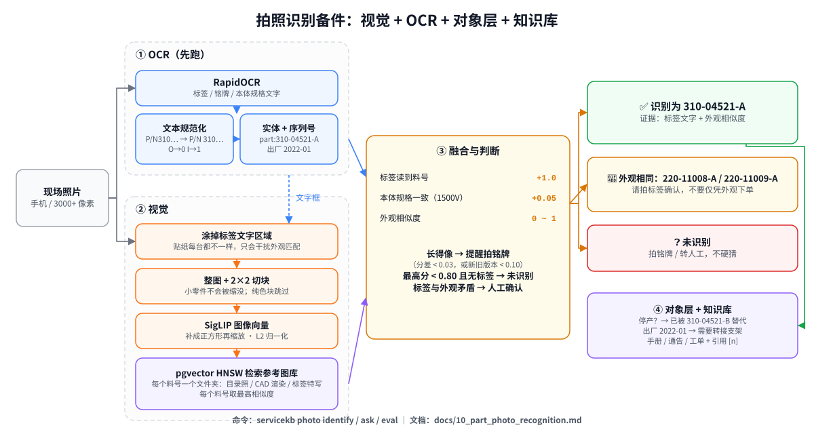

# 10 拍照识别备件（SigLIP + OCR + 知识库）

> 现场工程师拍一张零件照片，系统回答：**这是哪个料号、现在还能不能订、换什么、怎么换**——并且在拿不准的时候明确说"请拍铭牌确认"。
>
> 配套代码：`src/servicekb/vision/`；命令：`servicekb photo identify / ask / eval`；示例数据：`data/sample/part_images/`（参考图库）、`data/sample/photos/`（现场照片）。
>
> ⚠️ 示例图片全部是程序画的虚构零件（`scripts/make_sample_part_images.py`），默认的"手工特征"图像向量也只能认出这些画出来的零件。**真实照片必须用 SigLIP 等真正的图像模型，并在你们自己的照片上重新评估、校准阈值。**



---

## 1. 为什么不能只靠一个图像模型

| 现场的真实情况 | 只用图像模型会怎样 | 本方案的处理 |
| --- | --- | --- |
| 新旧版本外观几乎一样（310-04521-A / -B 只差一层防尘网） | 随机给一个，可能推荐停产件 | 物料主数据里有替代关系 → 放宽阈值提醒"新旧版本，请看标签" |
| 不同额定值外观相同（1100V / 1500V 直流开关） | **装错有拉弧风险** | 分差 < 0.03 → 提醒；本体印的 "1500V" 被 OCR 读到 → 加分并作为证据 |
| 零件只占照片一小块（3000+ 像素的原图） | 缩放到 384 像素后只剩几十个像素 | 整图 + 2×2 切块分别编码，取最相似的一块 |
| 每台机器的标签、贴纸、手写字都不一样 | 贴纸把外观特征"带偏" | **先 OCR，把标签区域涂掉**，再做外观匹配 |
| 拍到的东西根本不在图库里 | 硬猜一个最像的料号 | 最高相似度低于阈值且没读到标签 → "未识别" |
| 知道是哪个料号还不够 | — | 交给对象层（停产？替代件？）+ 知识库（怎么换、注意什么） |

核心原则和文本问答一样：**宁可说"不确定，请确认"，也不能自信地给出错误料号。** 评估里专门有一个指标盯着它（第 8 节）。

---

## 2. 整体流程

```text
照片 ─ 读取（按 EXIF 转正）
   ├─ ① OCR（先跑）：文字 + 文字框
   │      ├─ 规范化：P/N310-04521-B → P/N 310-04521-B；料号里的 O→0、I→1
   │      ├─ 实体链接：料号 / 型号 / 故障码（和知识库共用同一个对象层）
   │      ├─ 序列号 → 出厂年月（规则可配置）
   │      └─ 本体规格：1500V、40A ……
   ├─ ② 视觉：涂掉"像标签"的文字框 → 整图 + 切块 → 图像向量 → 参考图库检索 → 每个料号取最高相似度
   ├─ ③ 融合：标签料号 +1.0 / 规格一致 +0.05 / 外观相似度 0~1
   │      ├─ 长得像 → 提醒拍铭牌        ├─ 未识别 → 不硬猜
   │      └─ 标签与外观矛盾 → 人工确认
   └─ ④ 对象层事实（停产 / 替代 / 适用机型 / 出厂年月） + 知识库检索（手册 / 通告 / 工单） → 带引用的回答
```

代码对应：

| 步骤 | 文件 |
| --- | --- |
| 读取、补正方形、切块 | `vision/images.py` |
| 图像向量（手工特征 / SigLIP / HTTP 服务） | `vision/embedders.py` |
| OCR 与文本规范化 | `vision/ocr.py` |
| 融合、提醒、事实 | `vision/identify.py` |
| 参考图库 connector | `connectors/part_images.py` |
| 图片增量入库 | `pipeline/ingest.py::_index_images` |
| 图像向量表 | `store/migrations/002_image_embeddings.sql` |
| 照片 + 问题 → 回答 | `service.py::ask_with_photo` |
| 评估 | `vision/evaluate.py` |

---

## 3. SigLIP 入门

**是什么**：Google 的图文双塔模型（SigLIP 2023；SigLIP 2 于 2025 年发布）。一个图像编码器、一个文本编码器，在海量"图片-描述"对上训练，让配对的图片和文字的向量靠近。

**和 CLIP 的区别**：CLIP 用 softmax 对比损失（一个 batch 里所有样本互相比较），SigLIP 改成**逐对的 sigmoid 损失**（每一对图文独立判断"配不配"）。训练更省显存、小 batch 也稳定，图像特征质量通常更好。

**本项目怎么用**：只用**图像编码器**做"以图搜图"——参考图和现场照片编码到同一个向量空间，余弦相似度最高的参考图对应的料号就是候选。

| 常见权重 | 输入尺寸 | 向量维度 | 说明 |
| --- | --- | --- | --- |
| `google/siglip-base-patch16-224` | 224 | 768 | 小、快，适合先跑通 |
| `google/siglip-so400m-patch14-384` | 384 | 1152 | **推荐**：精度高，48GB 卡上 fp16 轻松跑 |
| `google/siglip2-so400m-patch14-384` | 384 | 1152 | SigLIP 2，多语言更好；NaFlex 变体支持保持原始长宽比 |

（维度不用手动填：`SiglipImageEmbedder` 启动时用一张空图探测输出维度，写进数据库的 `index_meta`。）

**为什么不用它的文本编码器做知识库检索**：它是为"图片配短描述"训练的，默认只看 64 个 token，不懂长段落检索，中文也不是强项。知识库文本检索继续用 bge-m3。

**零样本分类**（"a photo of a cooling fan" vs "a photo of a circuit board"）可以用来粗分大类，但分不清你们自己的具体零件；本项目没有用它做判断。

---

## 4. 参考图库：效果好坏的关键

### 4.1 目录约定

```text
data/sample/part_images/
├── 310-04521-B/          ← 文件夹名 = 料号（会自动规范化：大小写、空格）
│   ├── front.png         ← 文件名 = 视角（view），会记进数据库
│   └── render_rotated.png
└── 220-11009-A/
    └── front.png
```

在 `configs/sources.yaml` 里注册：

```yaml
- name: part_images
  type: part_images
  path: ../data/sample/part_images
  acl_groups: [public, service]
```

然后 `servicekb ingest`（或 `--only part_images`）。增量规则和文档一样：图片字节 + 模型 + 料号 + 视角 + 权限都没变就跳过；文件夹里删掉的图从索引里删掉。文件夹名对应的料号如果不在物料主数据里，会出现在导入报告的 `unknown_image_entities` 里。

### 4.2 每个料号准备什么图

| 图 | 数量 | 为什么 |
| --- | --- | --- |
| 正面 / 侧面 / 背面 | 2~3 | 现场从各种角度拍 |
| **装在机器里的样子** | 1~2 | 现场照片背景杂乱、有遮挡，和白底目录照差别很大 |
| 标签 / 铭牌特写 | 1 | 让外观和标签都能对上 |
| CAD 渲染图（结构件） | 多角度批量渲染 | 结构件通常没有标签，只能靠外形；能拿到 CAD 就批量出图 |

**长得像的零件一定要各有各的图**，而且要能看出差别的那个角度（防尘网、额定值标签、板卡上的版本号丝印）。

### 4.3 图从哪里来

- 备件目录 / 采购资料里的产品图；
- **历史工单附件里的现场照片**（最接近真实分布）——由工程师确认料号后放进对应文件夹；
- 拍照识别线上使用时，用户确认过的照片（见第 10 节的闭环）。

---

## 5. 高分辨率照片

现场照片通常 3000~4000 像素，而 SigLIP 输入只有 224~512 像素。处理办法（`vision/images.py`）：

1. **按 EXIF 方向转正**：手机竖拍的照片像素是横的，靠 EXIF 标记旋转。不处理，模型看到的是躺倒的零件。
2. **补成正方形再缩放**：SigLIP 的预处理会把图片拉伸成正方形，长条零件会被压扁。先用背景色补成正方形。
3. **整图 + 2×2 带重叠切块**：最长边 ≥ 1200 像素时启用（`SERVICEKB_IMAGE_TILE_MIN_SIDE`）。每块单独编码检索，每个料号取所有块里的最高分。**几乎纯色的块跳过**（判断标准是"和主色明显不同的像素占比"，而不是标准差——一个小零件在一大块墙面里，标准差很低，但它恰恰是最有用的那块）。

更好的做法（路线图）：先用目标检测模型（例如 YOLO / Grounding DINO）把零件框出来再编码。

---

## 6. OCR

### 6.1 引擎

| 引擎 | 说明 |
| --- | --- |
| `rapidocr`（推荐） | RapidOCR = PaddleOCR 模型的 ONNX 版，中英文都好，CPU 即可，`pip install -e ".[ocr]"` |
| `metadata` | **测试替身**：只读样例图片里预置的标签文字（JPEG comment），真实照片永远返回空。用于 CI |
| `auto`（默认） | 装了 rapidocr 就用 rapidocr，否则退回 metadata 并打印警告 |
| `none` | 关闭 |

条码 / 二维码（序列号经常以条码形式出现）可以按同样的接口加一个 pyzbar / zxing-cpp 实现。

### 6.2 OCR 结果的后处理（实测踩到的坑）

在示例照片上，RapidOCR 把 `P/N 310-04521-B` 读成了 `P/N310-04521-B`，把 `SN AS112203004561` 读成了 `SNAS112203004561`——**空格丢了**，料号正则里的 `\b` 就失效了，一个都认不出来。`normalize_ocr_text` 做了两件事：

1. 在常见的标签键后补空格：`P/N`、`S/N`、`PN`、`SN`、`料号`、`序列号`、`型号`、`MODEL`……
2. 在"形状像料号"的片段里修正数字位置上的常见混淆：`O→0`、`I/l→1`（不动普通文字）。

### 6.3 先 OCR，再涂掉标签做外观匹配

标签、贴纸、手写字每台机器都不一样，它们会把外观特征"带偏"。在示例数据上，一张贴了白色标签的风扇照片，外观相似度只有 0.46（同一个零件不贴标签的照片是 0.97），还触发了"标签与外观不一致"的误报；先涂掉标签区域后回到 0.90，误报消失。

所以顺序是：**先 OCR → 把"像标签"的文字框（含料号 / 序列号 / 标签键）向外扩 12 像素涂成背景色 → 再做外观匹配。**

注意只涂"像标签"的文字：
- OCR 的**误检**（示例里 RapidOCR 在电路板上误检出一个"中"字，框住了整块板）不能涂，否则零件本身被涂没了；
- 零件**本体上印的规格**（"1500V"）是外观的一部分，不能涂——它还会被用来加分（第 7 节）。

### 6.4 序列号 → 出厂年月

`SERVICEKB_SERIAL_NUMBER_PATTERN` 是一个带 `year` / `month` 命名组的正则。示例规则：`AS + 2 位机型码 + YYMM + 6 位流水号`。解析结果作为事实交给知识库，例如服务通告里写着"2023 年 1 月之前出厂的机器需要转接支架"，LLM 就能据此判断。

---

## 7. 融合规则与阈值

| 信号 | 分数 | 说明 |
| --- | --- | --- |
| 标签上读到该料号 | +1.0 | 最强证据，直接排到所有视觉候选前面 |
| 本体规格与料号名称一致（如 "1500V"） | +0.05 | 用来区分外观相同、规格不同的件 |
| 外观相似度 | 0~1 | 所有切块 × 所有参考图里的最高余弦相似度 |

| 判断 | 条件 | 配置 |
| --- | --- | --- |
| 识别成功 | 第一名有标签确认，或外观相似度 ≥ 阈值 | `SERVICEKB_PHOTO_MIN_VISUAL_SCORE`（默认 0.80） |
| 长得像 | 没有标签确认，且与第一名分差 ≤ 0.03；**或**与第一名在物料主数据中是替代 / 互换关系且分差 ≤ 0.10 | `SERVICEKB_PHOTO_LOOKALIKE_MARGIN` |
| 标签与外观矛盾 | 标签确认的料号，外观相似度比最高的低 0.15 以上 | — |
| 标签料号不在物料主数据 | — | 提醒人工确认（新料号？OCR 错？） |

**阈值必须重新校准**：换了图像模型（手工特征 → SigLIP）、换了照片来源，相似度的分布都会变。方法：在真实照片上跑 `servicekb photo eval`，看"正确匹配的相似度"和"图库外物体的最高相似度"两个分布，阈值放在中间。示例数据上（手工特征）前者是 0.865~0.998，后者是 0.71。

---

## 8. 评估

```bash
servicekb photo eval                 # 视觉 + OCR
servicekb photo eval --no-ocr        # 只看视觉：OCR 到底贡献了多少
servicekb photo eval --min-top1 0.9 --max-confident-wrong 0   # CI 门禁
```

| 指标 | 含义 |
| --- | --- |
| top1 / top3 | 正确料号排第一 / 进前三 |
| unknown_rejected | 图库外的东西，是否正确地说"未识别" |
| **confident_wrong** | 给出了一个料号、没有任何"请确认"的提醒、而且是错的。会导致发错货、装错件，**必须接近 0** |

示例数据（23 张：11 个料号 × 有 / 无标签 + 1 个图库外物体）上的结果：

| 模式 | top1 | top3 | 图库外拒识 | 自信答错 |
| --- | --- | --- | --- | --- |
| 视觉 + RapidOCR（真实 OCR） | 1.000 | 1.000 | 1.000 | **0.000** |
| 视觉 + OCR 测试替身 | 1.000 | 1.000 | 1.000 | **0.000** |
| 只看视觉 | 0.773 | 0.818 | 1.000 | **0.000** |

"只看视觉"时，贴了标签的照片因为没法涂掉标签，有一半认不出来——但都是"未识别"或"请确认"，没有自信答错。

> ⚠️ 这些数字只证明**逻辑是对的**（融合、提醒、拒识都按设计工作），不代表真实照片上的效果：示例图片是程序画的，图像向量是手工特征。

**真实评估集怎么建**：从历史工单里收集带照片、且工程师确认过料号的记录，每个常见料号 5~10 张，故意包含长得像的、光线差的、只拍到一部分的；再加 10% 图库外的东西（工具、别的厂家的零件）。标注格式和 `data/sample/photos/labels.jsonl` 相同。

---

## 9. 接入真实的 SigLIP

```bash
pip install -e ".[vision,ocr]"
```

```bash
# .env
SERVICEKB_IMAGE_EMBEDDING_BACKEND=siglip
SERVICEKB_IMAGE_EMBEDDING_MODEL=google/siglip-so400m-patch14-384
SERVICEKB_EMBEDDING_DEVICE=cuda:0
SERVICEKB_OCR_BACKEND=rapidocr
```

**换图像模型 = 重建图片索引**（向量维度和向量空间都变了）。数据库会拒绝启动并提示：

```sql
DELETE FROM image_embeddings;
DELETE FROM index_meta WHERE key LIKE 'image_%';
```

如果向量维度也变了（手工特征 137 维 → SigLIP so400m 1152 维），列的类型 `vector(139)` 需要改，最简单的是 `servicekb db reset --yes` 后重新 `db init` + `ingest`。

**已经有图像编码服务**（例如团队已部署的 SigLIP worker）：用 `http` 后端，不用在知识库进程里再加载一份模型：

```bash
SERVICEKB_IMAGE_EMBEDDING_BACKEND=http
SERVICEKB_IMAGE_EMBEDDING_URL=http://gpu-box:8090/embed
SERVICEKB_IMAGE_EMBEDDING_DIM=1152
```

接口约定见 `HTTPImageEmbedder` 的文档字符串（`POST {"images": [base64 PNG]}` → `{"embeddings": [[...]]}`），不一致的话改 `_post` 部分即可。

> 本仓库在开发环境里用**随机初始化的小 SigLIP 模型**验证了 `SiglipImageEmbedder` 的代码路径（加载、预处理、`get_image_features`、归一化），但**没有**下载真实权重跑过真实照片（开发环境访问不了 HuggingFace）。首次接入时请先跑 `servicekb photo eval` 确认。

---

## 10. 让它越用越准

1. **用户确认闭环**：`servicekb photo ask` / `/v1/photo/ask` 返回候选后，让现场工程师点"对 / 不对，应该是 X"。确认过的照片放进参考图库对应文件夹 → 下次 ingest 自动入库。这是成本最低、效果最好的改进方式。
2. **微调**（照片积累到每个料号几十张以后）：
   - 最简单：冻结 SigLIP，只训练一个线性分类头（linear probe），几分钟就能训完；
   - 更进一步：用对比学习微调图像编码器，**把长得像的零件作为困难负样本**（hard negatives），专门拉开 A / B 这类的距离；
   - 对比方案：DINOv2 在纯"以图搜图"的细粒度检索上往往更强，可以一起评估。
3. **结构件比对 CAD**：结构件通常没有标签，可以用 CAD 模型批量渲染多角度图放进图库；更进一步可以做轮廓 / 尺寸比对。
4. **多张照片一起判断**：一张拍全貌、一张拍标签，融合两张的结果。

---

## 11. API 与命令行

```bash
servicekb photo identify data/sample/photos/site_220-11009-A_nolabel.jpg
servicekb photo ask data/sample/photos/site_310-04521-A_label.jpg "怎么更换？需要什么配件？"
```

```bash
curl -X POST http://localhost:8000/v1/photo/identify \
  -H "X-API-Key: ..." -H "X-User-Groups: service" \
  -F image=@data/sample/photos/site_220-11009-A_label.jpg
```

```bash
curl -X POST http://localhost:8000/v1/photo/ask \
  -H "X-API-Key: ..." -H "X-User-Groups: service" \
  -F image=@data/sample/photos/site_310-04521-A_label.jpg -F question="怎么更换？"
```

上传上限 15 MB；不是图片返回 422。权限和文本问答一样：参考图有 `acl_groups`，检索时按用户组过滤。

---

## 12. 当前不足

| 不足 | 影响 | 改进方向 |
| --- | --- | --- |
| 没有目标检测 | 零件只占画面很小一部分时，靠切块"碰运气" | 先检测零件区域再编码 |
| 不读条码 / 二维码 | 序列号只能靠 OCR 读字 | 加 pyzbar / zxing-cpp |
| 每次只看一张照片 | 全貌和标签要分两次问 | 多照片会话融合 |
| 阈值是全局的 | 不同类别（板卡 vs 结构件）的相似度分布不同 | 按类别校准，或训练一个校准模型 |
| 没有用户确认闭环 | 图库只能人工维护 | 第 10 节第 1 点 |
| 真实 SigLIP 未在真实照片上验证 | — | 上线前必须跑评估 |
