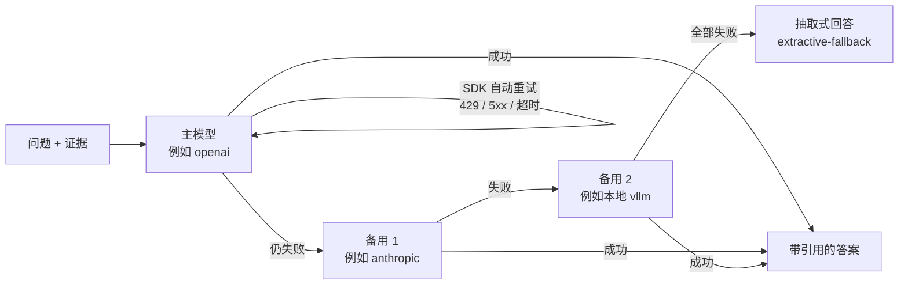

# 11 多厂家大模型接入（OpenAI / Claude / Gemini / DeepSeek / 通义 / 本地 vLLM ……）

> 读完这篇你会知道：怎么切换到某一家的大模型、怎么配置"主模型挂了自动换备用"、各家接口有哪些坑，
> 以及怎么接入一个新厂家。代码在 [`src/servicekb/generation/llm.py`](../src/servicekb/generation/llm.py)。

## 1. 为什么要支持多家

| 原因 | 说明 |
| --- | --- |
| 不被一家锁死 | 价格、效果、配额、服务地区都会变。换厂家应该是**改配置**，不是改代码 |
| 合规 | 有的数据（内部聊天记录、未公开的维修经验）不能发到外部 API，只能用本地模型；公开手册可以用云端模型 |
| 可用性 | 任何一家都可能限流、超时、故障。配了备用厂家，问答服务不中断 |
| 公平对比 | 同一套评估集（`servicekb eval`）换不同厂家跑，用数据而不是印象选模型 |

**大模型在这个系统里只做两件事**：

1. **问答生成**（`servicekb ask` / `POST /ask`）：把"问题 + 检索到的证据"组织成带引用的答案。
2. **聊天记录问答抽取**（`servicekb chat clean --llm`，可选）：从 Teams 对话里抽"问题 + 解决方案"。

检索、重排、对象层、拒答门槛都**不依赖**大模型，所以换厂家不影响检索效果，只影响"答案写得好不好"。
导入文档时也不调用大模型：文档内容只在**有人提问时**，以"检索到的几段证据"的形式发给大模型。

## 2. 支持的厂家

运行 `servicekb llm providers` 可以看到下面这张表（以及每家的 API Key 环境变量是否已设置）：

| provider | 接口 | 默认地址 | API Key 环境变量 | 说明 |
| --- | --- | --- | --- | --- |
| `extractive` | — | — | — | **默认**。不调用大模型，从证据里摘句子。离线 demo / CI / 降级 |
| `openai` | OpenAI 官方 SDK | 官方 | `OPENAI_API_KEY` | |
| `azure_openai` | OpenAI 官方 SDK（Azure） | 必须填 `https://<资源名>.openai.azure.com` | `AZURE_OPENAI_API_KEY` | model 填**部署名** |
| `anthropic` | Anthropic 官方 SDK | 官方 | `ANTHROPIC_API_KEY` | Claude。`pip install -e ".[anthropic]"`，默认模型 `claude-opus-5-5` |
| `anthropic_bedrock` | Anthropic 官方 SDK | AWS | AWS 默认凭证 | Claude on Amazon Bedrock，需要 `SERVICEKB_AWS_REGION` |
| `anthropic_vertex` | Anthropic 官方 SDK | Google Cloud | gcloud ADC | Claude on Vertex AI，需要 `SERVICEKB_GCP_PROJECT_ID` |
| `gemini` | OpenAI 兼容 | Google 官方兼容接口 | `GEMINI_API_KEY` | |
| `deepseek` | OpenAI 兼容 | `https://api.deepseek.com` | `DEEPSEEK_API_KEY` | |
| `qwen` | OpenAI 兼容 | 阿里云百炼 compatible-mode | `DASHSCOPE_API_KEY` | 海外账号把地址换成 dashscope-intl |
| `moonshot` | OpenAI 兼容 | `https://api.moonshot.cn/v1` | `MOONSHOT_API_KEY` | Kimi |
| `zhipu` | OpenAI 兼容 | `https://open.bigmodel.cn/api/paas/v4/` | `ZHIPUAI_API_KEY` | GLM |
| `vllm` | OpenAI 兼容 | `http://localhost:8000/v1` | 不需要 | 本地部署，**数据不出公司** |
| `ollama` | OpenAI 兼容 | `http://localhost:11434/v1` | 不需要 | 本地部署（小模型 / 笔记本试用） |
| `openai_compatible` | OpenAI 兼容 | 必须填 | `OPENAI_API_KEY` | 其他任何兼容服务：企业网关、LiteLLM、One API …… |

> 地址和模型名以各厂商官方文档为准。厂商改了地址，用 `SERVICEKB_LLM_BASE_URL` 覆盖即可，不用改代码。
> 模型名更新很快，表里只给示例；除了 Claude，**模型名必须自己填**（`SERVICEKB_LLM_MODEL`），填错会报 404。

## 3. 怎么配置

所有配置都是环境变量（或 `.env` 文件），完整示例见 [`.env.example`](../.env.example)。

```bash
# OpenAI
export SERVICEKB_LLM_PROVIDER=openai
export OPENAI_API_KEY=sk-...
export SERVICEKB_LLM_MODEL=gpt-4.1-mini

# Claude（官方 API）
pip install -e ".[anthropic]"
export SERVICEKB_LLM_PROVIDER=anthropic
export ANTHROPIC_API_KEY=sk-ant-...
# SERVICEKB_LLM_MODEL 不填默认 claude-opus-5-5

# DeepSeek / 通义 / Kimi / 智谱 / Gemini：地址已内置，只需要 Key 和模型名
export SERVICEKB_LLM_PROVIDER=deepseek
export DEEPSEEK_API_KEY=sk-...
export SERVICEKB_LLM_MODEL=deepseek-chat

# 本地 vLLM（96GB 卡可跑 30B 级模型）
export SERVICEKB_LLM_PROVIDER=vllm
export SERVICEKB_LLM_BASE_URL=http://gpu-box:8000/v1
export SERVICEKB_LLM_MODEL=Qwen/Qwen3-32B
```

配好以后**先测连通性**（会发一条很短的请求，产生极少量费用）：

```bash
servicekb llm test              # 测问答
servicekb llm test --json-mode  # 同时测 JSON 结构化输出（chat clean --llm 要用）
```

临时换一家试试，不改配置：

```bash
servicekb ask "E037 怎么处理？" --provider deepseek --llm-model deepseek-chat
servicekb chat clean --llm --provider vllm --llm-model Qwen/Qwen3-32B
```

API Key 的读取顺序：`SERVICEKB_LLM_API_KEY` → 厂家自己的环境变量（上表）→ （仅 Claude）SDK 自己的凭证查找。
**Key 不要写进代码、`sources.yaml` 或提交到 git**（见 [docs/06](06_deployment.md) 安全清单）。

### 通用参数

| 配置 | 默认 | 说明 |
| --- | --- | --- |
| `SERVICEKB_LLM_TEMPERATURE` | `0.1` | 问答要"稳"，温度低。写 `none` 表示不发送（OpenAI 推理模型只接受默认温度）。Claude 自动不发 |
| `SERVICEKB_LLM_MAX_TOKENS` | Claude 16000，其他 1024 | 输出上限。Claude 的思考过程也计入输出，所以给得大一些 |
| `SERVICEKB_LLM_TIMEOUT_S` | `60` | 单次请求超时 |
| `SERVICEKB_LLM_MAX_RETRIES` | `2` | SDK 内置重试（429 限流 / 5xx / 网络错误，指数退避） |
| `SERVICEKB_LLM_EFFORT` | `medium` | 仅 Claude：思考深度 `low / medium / high / xhigh / max`。RAG 问答 medium 足够；越高越慢越贵 |
| `SERVICEKB_ANTHROPIC_SERVER_FALLBACKS` | `true` | 仅 Claude 官方 API：被安全分类器拒答时由服务端换模型重跑，见第 5 节 |

## 4. 主备切换：一层一层地兜底



配置备用厂家（JSON 数组，按顺序尝试；每项字段和主模型一样，只是去掉 `llm_` 前缀）：

```bash
export SERVICEKB_LLM_FALLBACKS='[
  {"provider": "anthropic", "model": "claude-opus-5-5"},
  {"provider": "vllm", "model": "Qwen/Qwen3-32B", "base_url": "http://gpu-box:8000/v1"}
]'
```

四层兜底，从快到慢：

1. **SDK 重试**：同一家，429 / 5xx / 网络错误自动重试 `LLM_MAX_RETRIES` 次。
2. **Claude 服务端 fallback**（仅 Claude 官方 API）：被安全分类器拒答时，服务端自动换模型重跑，客户端无感知。
3. **备用厂家**（`LLM_FALLBACKS`）：上一家抛错（重试用完、鉴权失败、拒答、空回复）就换下一家。
4. **抽取式回答**：所有厂家都失败时，从证据里摘原文句子，答案标记 `model=extractive-fallback`，
   `reason` 里记录错误。宁可给"相关原文"，也不让用户看到报错页面。

每次回答实际用的是哪一家，记录在 `AnswerResult.model`（例如 `vllm:Qwen/Qwen3-32B`）和查询日志里，
方便统计"主模型失败率"——如果备用厂家经常顶上，说明主模型的配额或稳定性有问题。

> **注意：换厂家会改变答案的风格和质量。** 上线前用 `servicekb eval` 把主模型和每个备用模型都跑一遍，
> 确认备用模型也达标（尤其是引用格式 `[1]` 和"证据不足就说不知道"这两条规则）。

## 5. 各家接口的差异（adapter 替你处理了）

上层代码只调用一个方法：`ChatModel.complete(system, user, json_schema=None) -> str`，失败一律抛 `LLMError`。
各家的差异都收在 adapter 里：

| 差异点 | OpenAI 官方 / Azure | OpenAI 兼容（DeepSeek、通义、vLLM……） | Claude |
| --- | --- | --- | --- |
| 系统提示 | 第一条 `system` 消息 | 同左 | 单独的 `system` 参数 |
| 输出长度参数 | `max_completion_tokens` | `max_tokens` | `max_tokens`（**必填**，思考也计入） |
| 温度 | 支持（推理模型除外） | 支持 | **不支持**（发送会 400），adapter 不发；用 `effort` 控制思考深度 |
| JSON 输出 | `json_schema` 严格模式 | 多数只支持 `json_object`：adapter 把 schema 写进系统提示 | `output_config.format`（结构化输出） |
| 拒答 | 内容为空 / `finish_reason` | 同左 | HTTP 200 + `stop_reason: "refusal"`，必须先检查 |
| 返回内容 | 一段文字 | 同左 | 多个内容块（思考块 + 文字块），**只取文字块** |
| Azure 特有 | URL 带部署名和 `api-version`，Key 放 `api-key` 头 | — | — |

### Claude 的几个要点

- **思考默认开启**：当前的 Claude 模型会先"想"再回答，思考的 token 也算输出、也计费。
  `SERVICEKB_LLM_EFFORT` 控制想多深：简单问答用 `low` / `medium`，复杂故障分析可以试 `high`。
- **没有 temperature**：不要以为"调低温度能让答案更稳"——Claude 上这个旋钮不存在，稳定性靠提示词和证据门槛。
- **拒答**：安全分类器可能拒绝某些请求（返回 `stop_reason: "refusal"`）。adapter 把它转成 `LLMError`，
  于是会走到备用厂家 / 抽取式回答。官方 API 上默认开启了服务端 fallback（beta 功能
  `server-side-fallback-2026-07-01`，`fallbacks="default"`），大多数情况下服务端会先替你换模型重跑。
  不想要可以设 `SERVICEKB_ANTHROPIC_SERVER_FALLBACKS=false`。Bedrock / Vertex 上没有这个功能，adapter 自动不发。
- **Bedrock / Vertex**：模型名格式不同（Bedrock 默认 `anthropic.claude-opus-5-5`），凭证走云厂商自己的方式
  （AWS 凭证链 / `gcloud auth application-default login`），不需要 Anthropic 的 Key。

### JSON 结构化输出：为什么还要校验

`chat clean --llm` 需要模型输出固定格式的 JSON（[`chat/llm_extract.py`](../src/servicekb/chat/llm_extract.py)
的 `EXTRACTION_SCHEMA`）。schema 的写法遵循各家都支持的子集：所有字段 required、不允许多余字段、
不用 `minimum` / `maximum` 这类数值约束（部分厂家不支持，范围在代码里校验）。

即使格式保证了，**内容**仍可能有问题，所以抽取后照样校验：证据消息编号必须真实存在、料号 / 故障码必须在原对话里出现过、
置信度截断到 0~1。不同厂家"编造料号"的倾向不同——换厂家后先抽检一批（docs/09 第 10 节）。

## 6. 数据合规：什么数据会发给大模型

| 场景 | 发送的内容 | 建议 |
| --- | --- | --- |
| 问答 | 用户的问题 + 检索到的 3~8 段证据（已按用户权限过滤）+ 结构化事实 | 公开手册类问题可用云端模型；涉及内部工单的问题评估后再定 |
| 聊天抽取 | 整段对话（**已脱敏**：PII 掩码 + 人名化名） | **优先用本地模型**（`vllm` / `ollama`） |
| 导入文档 | 不发送 | — |

一个常见的折中：问答主模型用云端（效果好），聊天抽取用本地 vLLM（数据不出公司）——
`chat clean --llm --provider vllm` 就能单独指定，不影响问答的配置。

**上线前请和公司的信息安全 / 法务确认**：哪些数据可以发给哪些厂家、数据存放在哪个地区、厂家是否会用你的数据训练模型。

## 7. 怎么选厂家

不要凭印象选，用数据选：

1. 准备好评估集（[docs/05](05_evaluation.md)），至少包含：常见故障码、料号替代、跨型号问题、应该拒答的问题。
2. 每个候选厂家跑一遍：`SERVICEKB_LLM_PROVIDER=xxx SERVICEKB_LLM_MODEL=yyy servicekb eval`。
3. 比较：关键事实召回（must_include）、拒答准确率、引用是否正确、延迟（报告里有 timings）、单次成本。
4. 再考虑合规（数据能不能出境）、配额、团队已有的云账号（Azure / AWS / GCP 上用对应的托管版本，账单和权限更好管理）。

经验法则：**检索质量决定上限，模型决定离上限有多近**。如果换了几家模型 must_include 都上不去，问题多半在检索或数据，不在模型。

## 8. 接入一个新厂家

**情况 1：它兼容 OpenAI 接口**（绝大多数国内厂商、推理框架、企业网关都是）——
不用写代码，直接用 `openai_compatible`：

```bash
export SERVICEKB_LLM_PROVIDER=openai_compatible
export SERVICEKB_LLM_BASE_URL=https://api.example.com/v1
export SERVICEKB_LLM_API_KEY=...
export SERVICEKB_LLM_MODEL=example-model
```

想让它成为"一等公民"（有名字、有默认地址），在 `llm.py` 的 `PRESETS` 里加一行：

```python
"example": Preset("openai", "https://api.example.com/v1", "EXAMPLE_API_KEY", example_model="example-model"),
```

**情况 2：只有自己的 SDK / 协议**——写一个 `ChatModel` 子类（参考 `AnthropicChatModel`），实现 `complete()`，
把厂家的异常都转成 `LLMError`，然后在 `_build_one()` 里按 `preset.kind` 分发。别忘了：

- 只返回最终答案的文字（不要把思考过程、工具调用之类的混进来）；
- 拒答 / 空回复 / 被截断要么抛 `LLMError`，要么打日志，不能静默返回半截答案；
- 写测试：用 Mock HTTP 传输层检查请求格式（参考 [`tests/test_llm.py`](../tests/test_llm.py)），不需要真的 Key。

## 9. 常见问题排查

| 现象 | 原因 / 处理 |
| --- | --- |
| `llm provider 'xxx' needs a model name` | 没填 `SERVICEKB_LLM_MODEL`（只有 Claude 有默认模型） |
| HTTP 401 / 403 | Key 不对，或者 Key 放错了环境变量（`servicekb llm providers` 看 ✓ / ✗） |
| HTTP 404 / `model not found` | 模型名写错，或者账号没有这个模型的权限；Azure 要填**部署名**不是模型名 |
| HTTP 400，提到 `temperature` | 该模型不支持温度：`SERVICEKB_LLM_TEMPERATURE=none` |
| HTTP 400，提到 `max_completion_tokens` / `response_format` | 这是兼容接口，不是 OpenAI 官方：用对应的 provider 名或 `openai_compatible` |
| 答案经常是 `extractive-fallback` | 大模型调用失败，看日志里的 `llm_error`；超时可以调大 `SERVICEKB_LLM_TIMEOUT_S` |
| `chat clean --llm` 很多 `llm_error_fallback_rule` | 模型输出的 JSON 不合法：换支持结构化输出的模型，或先用 `llm test --json-mode` 验证 |
| `provider=anthropic* 需要 Anthropic SDK` | `pip install -e ".[anthropic]"` |
| Claude 回答被截断（日志 `truncated by max_tokens`） | 思考占了太多输出：调大 `SERVICEKB_LLM_MAX_TOKENS` 或调低 `SERVICEKB_LLM_EFFORT` |

## 10. 当前不足和改进方向

- **没有流式输出**：现在是等完整答案再返回。前端要"打字机效果"需要加 `complete_stream()`，API 改成 SSE。
- **没有记录 token 用量和成本**：应该把每次调用的输入 / 输出 token 记进查询日志，按厂家统计成本。
- **没有按任务路由**：目前问答和聊天抽取共用一个主模型配置（命令行可临时覆盖）。可以加"按任务 / 按问题难度选模型"，
  例如简单问题用便宜的模型、复杂故障分析用强模型。
- **没有提示词缓存**：系统提示词是固定的，Claude / OpenAI 都支持缓存重复前缀来降低成本和延迟，量大时值得加。
- **主备切换是"失败才切"**：没有熔断（主模型连续失败 N 次后一段时间内直接走备用）和健康检查，主模型故障期间每个请求都要先等一次超时。
- **兼容接口的 JSON 只是"尽力而为"**：`json_object` 不保证符合 schema，靠校验兜底。vLLM 可以开启 guided decoding（`guided_json`）做严格约束。
